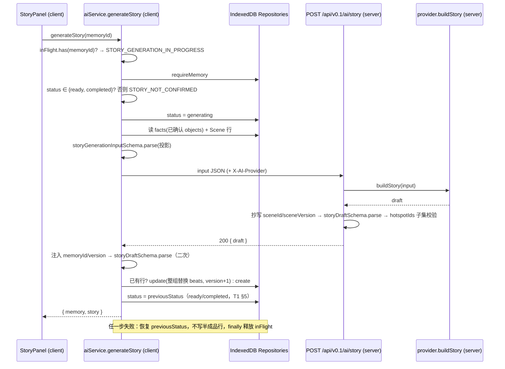

# T4 · API v0.1 契约设计

状态：设计定稿（仅文档，不含 src 实现；不新增任何依赖，采用等价表格而非 OpenAPI 工具链）
输入：T1 `docs/story-domain-model.md`、T2 `docs/story-schema-design.md`、`src/services/ai/aiService.js`、`src/services/ai/aiProvider.js`、`src/schemas/*`、`src/lib/constants.js`、`src/services/storage/*`、AGENTS.md §3/§4/§5/§6

## 0. 现状事实（设计依据）

- **当前不存在任何服务端路由**：`src/app` 下无 `api` 目录；`MemoryAnalysisPanel` / `MemoryScenePanel` 等客户端组件直接 import `aiService` 并在浏览器内调用 provider（目前仅 mock）。密钥管理尚未实现（全仓无 `process.env` / `API_KEY` 命中）。
- 事实上的"请求/响应契约"是 service 函数形状：`analyzeMemory → { memory, draft }`、`generateScene → { memory, scene }`（aiService.js:217、357）；错误统一为带 `code` 的 `StorageError` / `AiError`，UI 用 `ERROR_CODES` 为 key 的文案字典消费（MemoryAnalysisPanel.jsx / MemoryScenePanel.jsx）。
- provider 输入边界已刻意最小化：`analysisInputSchema` / `sceneGenerationInputSchema` / T2 `storyGenerationInputSchema` 只含用户文字、已确认 facts 投影、图片元数据与热点 id/name，**不含文件名、图片字节、未确认事实**。这是 API 化可以直接复用的现成网络边界。
- `inFlight` 是模块级 `Set<memoryId>`（aiService.js:22），analyze 与 generateScene 已共用同一守卫；失败恢复 `previousStatus`、finally 释放。
- draft 与持久化行的字段差：`analysisDraftSchema.revision` default 1（analysisSchema.js:75），`sceneDraftSchema` 省略 id/createdAt/updatedAt（sceneSchema.js:102-106），T2 `storyDraftSchema` 同型。revision / version / id / 时间戳全部由**客户端**在落库前注入（aiService.js:205、334-338）。
- Asset.blob 是 `instanceof Blob`（assetSchema.js），不可 JSON 序列化——图片字节在契约层面就不可能过网络。

## 1. 首要决策 D1 · 服务端/客户端边界

**结论：服务端只做"无状态 AI 计算"，浏览器是唯一持久化写入方。**

- **走服务端路由**：一切 provider 调用（analyze / buildScene / buildStory）。请求体 = 既有 input schema 的 JSON 投影，响应体 = draft schema 的 JSON。服务端持有 registry 与密钥，**零持久化、零会话状态**。
- **留在本地 repository/service**：Memory/Asset/Scene/Exploration/Story 的全部 CRUD、审阅合并（mergeWithPreviousDraft）、确认投影（confirmedCopy / adoptedBeatCopy）、门控（status 检查）、inFlight 守卫、revision/version 注入、stale 派生。

**理由**：
1. IndexedDB 只存在于浏览器（AGENTS §4 本地持久化）。若 story 读取/更新/确认走 REST，服务端必须有自己的数据库并引入双向同步——直接违反本地持久化 MVP 与最小变更原则（§6）。
2. input schema 已经是"可安全过网络的最小投影"（T2 D6），服务端无需读任何本地行即可计算 draft；门控与合并所需的 memory/scene 上下文只有浏览器有，留在客户端是数据引力决定的，不是妥协。
3. 无状态服务端不引入会话存储、任务队列、job 轮询等新机制；`POST → draft` 一次往返，与现有 `provider.analyze(input)` 调用形状一一对应，aiService 改造量最小。

**被否方案**：
- A. 全资源 REST（服务端 DB 为权威源）：否因见理由 1；且 Blob 上传触碰图片边界设计。
- B. 服务端持有会话态（memory 快照 / job 表）以在服务端做门控：否因——需要把本地行同步上服务端，引入双写与一致性问题；门控的安全本质由 schema 门控（T2 R1–R4）兜底，status 门控留在客户端单写入方内即可（见 §7 威胁模型说明）。

### 1.1 职责切分表

| 职责 | 归属 | 载体 |
| --- | --- | --- |
| provider registry / 密钥 / AI 调用 | 服务端 | `src/app/api/v0.1/ai/*/route.js`（新增） |
| input 构造（facts 投影、scene 绑定块） | 客户端 | aiService（既有模式） |
| 生成门控（status ∈ ready/completed） | 客户端 | aiService，发起 HTTP 前 |
| inFlight 防重入 | 客户端 | aiService 模块级 Set |
| draft 校验 | **两侧** | 服务端校验 provider 原始输出；客户端校验注入/合并后的 draft |
| revision / version / id / 时间戳注入 | 客户端 | aiService + Repository stamped |
| 审阅合并、确认/采纳投影 | 客户端 | mergeWithPreviousDraft / confirmedCopy / adoptedBeatCopy |
| 全部持久化与级联删除 | 客户端 | Repository + IndexedDB 事务 |
| stale 派生（sceneVersion 比对） | 客户端 | 视图层，不落库（T1 D3） |

### 1.2 密钥隔离规则（验收硬约束）

1. 密钥只经服务端 `process.env` 读取；**禁止** `NEXT_PUBLIC_` 前缀承载任何密钥。
2. 客户端 bundle 不得 import `src/services/ai/providers/*` 与 registry 实例。现有 `aiService.js:16-18` 对 mockProvider 的直接 import 必须在实现阶段切断，改为 fetch 服务端路由（这是"AI 请求必须走服务端 API"从文档规则变为构建事实的关键一步）。
3. 请求体永远不含 Blob、文件名、图片字节（input schema strict 强制，T2 A21）；响应体永远不含密钥、provider 内部配置。
4. `simulated: z.literal(true)` 徽标契约不变：接真实 provider 时服务端与客户端同步放宽 literal（analysisSchema.js:71-73 既有约定）。

## 2. 版本化策略 D2

**结论：URL 前缀 `/api/v0.1`**，路由目录 `src/app/api/v0.1/ai/...`。

- 否掉 header 版本化：App Router 按目录映射路由，URL 前缀零协商成本、可直接 curl 调试、缓存语义明确。
- v0.1 内**只增不改**：新增端点、新增错误码、响应新增可选字段均为非破坏变更（UI 错误字典对未知 code 走兜底文案）。任何请求/响应形状破坏性变更 → `/api/v0.2`，旧前缀保留至客户端迁移完成。
- API 版本与 `DB_VERSION`（T3 升至 2）相互独立：前者管网络形状，后者管本地迁移。

## 3. REST 端点表（服务端，全部无状态）

通用约定：
- 请求 `Content-Type: application/json`；可选 header `X-AI-Provider: <name>` 选择 provider，缺省用服务端 `DEFAULT_AI_PROVIDER`。**provider 选择不进请求体**——三个 input schema 均 `.strict()`，加字段会破坏与 T2 的一一对应。
- 成功响应 `200`，JSON 形状见各端点；失败响应统一错误信封（§5）。
- 无认证（单用户本地应用、同源调用）；公网部署时的限流/鉴权属未来任务，不在 v0.1 契约内（密钥本身仍只在服务端）。
- 生成类 POST **非幂等**：每次调用产出新 draft；客户端不得自动重试（§6.3）。

| # | 方法 | 路径 | 请求体 schema | 成功响应（200） | 替代的现有调用 |
| --- | --- | --- | --- | --- | --- |
| E1 | POST | `/api/v0.1/ai/analyze` | `analysisInputSchema`（analysisSchema.js:100-121） | `{ "draft": analysisDraftSchema }` | `provider.analyze(input)`（aiService.js:200） |
| E2 | POST | `/api/v0.1/ai/scene` | `sceneGenerationInputSchema`（sceneSchema.js:88-99） | `{ "draft": sceneDraftSchema }` | `provider.buildScene(input)`（aiService.js:328） |
| E3 | POST | `/api/v0.1/ai/story` | `storyGenerationInputSchema`（T2 §2） | `{ "draft": storyDraftSchema }`（T2 §2） | 新增 `provider.buildStory(input)`（T1 §8） |
| E4 | GET | `/api/v0.1/ai/providers` | 无 | `{ "providers": string[], "defaultProvider": string }` | `listAiProviders()`（aiService.js:161） |

### 3.1 E1 · POST /ai/analyze

请求示例（最小）：

```json
{
  "memoryId": "memory-1",
  "title": "食堂的中午",
  "description": "",
  "imageCount": 2,
  "images": [{ "mimeType": "image/jpeg", "width": 4032, "height": 3024 }]
}
```

响应示例（节选，完整形状 = analysisDraftSchema）：

```json
{
  "draft": {
    "provider": "mock",
    "simulated": true,
    "generatedAt": 1700000000000,
    "basedOn": { "imageCount": 2, "descriptionLength": 0, "hasDate": false, "hasLocation": false },
    "quality": "B",
    "summary": null,
    "scene": { "type": "cafeteria", "title": "食堂", "sourceType": "ai_inferred" },
    "elements": [], "tags": [], "times": [], "places": [], "missing": []
  }
}
```

- 服务端返回 **provider 原始 draft**（revision 可省略，schema default 1）。`revision = (memory.analysis?.revision ?? 0) + 1` 与 `mergeWithPreviousDraft` 仍由客户端执行（aiService.js:205-210 既有逻辑不动）——合并需要本地上一版 draft，服务端无从得知。
- 服务端义务：`analysisInputSchema.parse(body)` → `registry.get(header ?? default)` → `provider.analyze` → `analysisDraftSchema.parse(输出)`，任一失败按 §5 映射。

### 3.2 E2 · POST /ai/scene

请求示例：

```json
{
  "memoryId": "memory-1",
  "title": "食堂的中午",
  "sceneType": "cafeteria",
  "objects": ["餐盘", "餐桌"],
  "imageCount": 2
}
```

响应 `{ "draft": sceneDraftSchema }`：memoryId 由 provider 从输入回显，version 可省略（default 1）。客户端注入 `version = existing ? existing.version + 1 : SCENE_INITIAL_VERSION` 并二次校验（aiService.js:334-338 既有逻辑不动）。

### 3.3 E3 · POST /ai/story（新增）

请求示例（T2 §4.5 原样）：

```json
{
  "memoryId": "memory-1",
  "title": "食堂的中午",
  "sceneType": "cafeteria",
  "objects": ["餐盘", "餐桌"],
  "imageCount": 2,
  "scene": {
    "id": "scene-1",
    "version": 2,
    "hotspots": [
      { "id": "hotspot-1", "name": "餐盘" },
      { "id": "hotspot-2", "name": "餐桌" }
    ]
  }
}
```

响应示例（T2 §4.3 原样，包一层信封）：

```json
{
  "draft": {
    "provider": "mock",
    "simulated": true,
    "generatedAt": 1700000000000,
    "memoryId": "memory-1",
    "sceneId": "scene-1",
    "sceneVersion": 2,
    "title": "食堂的中午",
    "beats": [
      {
        "id": "beat-1",
        "value": "中午的食堂很热闹。",
        "baseline": "中午的食堂很热闹。",
        "sourceType": "ai_inferred",
        "hotspotIds": ["hotspot-1"]
      }
    ]
  }
}
```

服务端义务（T2 §6.3/§6.4 在网络边界的落点）：
1. `storyGenerationInputSchema.parse(body)`。
2. `provider.buildStory(input)`；provider 不存在或缺 `buildStory` → `AI_PROVIDER_UNAVAILABLE`。
3. **绑定抄写**：用 `input.scene` 覆写 draft 的 `sceneId / sceneVersion`（scene 为 null 则双 null），provider 不得自造绑定。
4. `storyDraftSchema.parse` → 失败 `STORY_INVALID_RESULT`（R4 在此拦截 provider 冒充确认/预采纳）。
5. **越界校验**：每个 beat 的 `hotspotIds ⊆ input.scene.hotspots[].id`，越界 → `STORY_INVALID_RESULT`（schema 无法跨输入/输出校验，归属持有两者的服务端路由）。

客户端义务（generateStory 编排，见 §4.1）：门控、version 注入、落库、失败恢复 previousStatus。

### 3.4 E4 · GET /ai/providers

```json
{ "providers": ["mock"], "defaultProvider": "mock" }
```

用途：客户端发现合法 `X-AI-Provider` 取值；registry 是服务端事实，客户端不再维护 provider 名单。

### 3.5 字段注入责任表（draft → 持久化行）

| 字段 | 注入方 | 规则 |
| --- | --- | --- |
| analysis.revision | 客户端 aiService | previous + 1（既有） |
| scene.version / story.version | 客户端 aiService | 原地重生成 existing + 1，否则 INITIAL_VERSION（既有模式，T1 §5） |
| scene.memoryId / story.memoryId | 客户端 aiService | 以本地 memory.id 覆写（既有 aiService.js:336） |
| story.sceneId / sceneVersion | **服务端路由**抄写 + 客户端合并校验 | 从 input.scene 抄写（T2 §6.4） |
| id / createdAt / updatedAt | 客户端 Repository | stamped，服务端响应永不含这三字段 |
| beat 采纳字段（sourceType/confirmed/adopted） | 客户端 adoptedBeatCopy | 唯一可 grep 入口（T2 §6.5），不经网络 |

## 4. 本地操作契约表（浏览器，无 HTTP）

story 的读取/更新/确认**不设 REST 端点**（D1）：它们是单写入方内的 repository 操作，契约由 schema + 错误码表达，与 REST 端点同等约束力。

| # | 操作 | 入口（新增/既有） | 校验 schema | 错误码 |
| --- | --- | --- | --- | --- |
| L1 | story 生成编排 | `aiService.generateStory(memoryId, { providerName })`（新增，T1 §8） | 门控 + storyGenerationInputSchema + storyDraftSchema | MEMORY_NOT_FOUND / STORY_NOT_CONFIRMED / STORY_GENERATION_IN_PROGRESS / AI_PROVIDER_UNAVAILABLE / STORY_INVALID_RESULT / STORY_GENERATION_FAILED / STORAGE_FAILED |
| L2 | story 读取 | `StoryRepository.getByMemoryId(memoryId)`（T3） | storySchema（读时校验） | STORAGE_FAILED；无行返回 null，**不是错误** |
| L3 | story 更新（标题/编辑段落） | `StoryRepository.update(id, patch)`（T3） | storyPatchSchema → 合并后完整 storySchema | STORY_NOT_FOUND / VALIDATION_FAILED / STORAGE_FAILED |
| L4 | story "确认" = beat 采纳 | UI 调 `adoptedBeatCopy(beat, editedValue)` 后走 L3 整组替换 beats | storyBeatSchema R2/R3 门控 | VALIDATION_FAILED（A2/A3/A17/A18 攻击路径） |
| L5 | story 删除 | 无独立入口；随 Memory 级联（T1 §3，T3 落实） | — | — |
| L6 | analysis 读取/保存/确认 | readAnalysis / saveAnalysisDraft / confirmAnalysis（既有，不改） | analysisDraftSchema | AI_ANALYSIS_NOT_FOUND / AI_INVALID_RESULT / MEMORY_NOT_FOUND |
| L7 | scene 读取 / 热点访问 | readScene / visitHotspot（既有，不改） | sceneSchema | SCENE_NOT_FOUND / VALIDATION_FAILED |
| L8 | memory / asset CRUD | memoryService + repositories（既有，不改） | memorySchema / assetSchema | MEMORY_NOT_FOUND / IMAGES_REQUIRED / 导入类 reasonCode |

补充约定：
- **stale 不是错误**：读取时 `scene.version ≠ story.sceneVersion` 或 beat.hotspotIds 含不存在 id → 视图层派生 stale 标记，不抛错、不落库（T1 D3）。因此不设 STORY_STALE 错误码。
- story 无自有 status（T1 §5）：L2 响应可附带派生视图 `{ story, stale }`，由 service 组装，repository 只返回行。
- 生成期间（memory.status = generating）UI 禁用 story 编辑：重生成整组替换 beats，会覆盖在途编辑（与 scene 重生成同策略）。

### 4.1 generateStory 编排时序（衔接现有流程）



与既有流程的衔接点：analyze（E1）/ confirm（L6）/ generateScene（E2）的客户端编排**形状不变**，仅把 `provider.xxx(input)` 一行替换为 fetch；门控、合并、落库、错误归一化、inFlight 全部原样保留。confirmAnalysis 不需要任何网络调用。

## 5. 错误契约

### 5.1 错误信封（服务端所有非 2xx 响应）

```json
{ "error": { "code": "STORY_INVALID_RESULT", "message": "故事结果不符合约定的数据结构" } }
```

- `code` ∈ ERROR_CODES（含新增 STORY_*），`message` 为中文用户文案（与现有 AiError message 同风格）。
- 客户端 fetch 封装把信封**还原为 `AiError(code, message)`** 抛出——UI 的 `error.code → 文案` 字典零改动继续工作。
- 框架级 404（未知路径）/ 405（方法不符）由 Next 默认处理，不带信封；客户端封装对无信封的非 2xx 兜底为对应域的 `*_GENERATION_FAILED / AI_ANALYSIS_FAILED`。

### 5.2 新增 STORY_* 错误码（constants.js ERROR_CODES 追加，与 SCENE_* 同型）

```js
STORY_NOT_FOUND: "STORY_NOT_FOUND",
STORY_ALREADY_EXISTS: "STORY_ALREADY_EXISTS",
STORY_NOT_CONFIRMED: "STORY_NOT_CONFIRMED",
STORY_GENERATION_IN_PROGRESS: "STORY_GENERATION_IN_PROGRESS",
STORY_GENERATION_FAILED: "STORY_GENERATION_FAILED",
STORY_INVALID_RESULT: "STORY_INVALID_RESULT",
```

不新增其他码：输入校验复用 VALIDATION_FAILED / AI_INVALID_INPUT，stale 是派生态不是错误（§4），provider 缺失复用 AI_PROVIDER_UNAVAILABLE。

### 5.3 错误码 → HTTP 状态映射（服务端发出的码）

| 错误码 | HTTP | 触发路径 |
| --- | --- | --- |
| VALIDATION_FAILED | 400 | 请求体 JSON 解析失败 / input schema parse 失败 |
| AI_INVALID_INPUT | 400 | provider 入口重 parse 输入失败（防御纵深，正常已被路由拦截） |
| AI_PROVIDER_UNAVAILABLE | 400 | X-AI-Provider 未注册，或 provider 缺 analyze/buildScene/buildStory（客户端可改选 E4 列出的 provider，故归 4xx） |
| AI_INVALID_RESULT | 502 | analyze 输出不合 analysisDraftSchema |
| AI_ANALYSIS_FAILED | 502 | analyze 兜底（provider 抛错/未知异常） |
| SCENE_INVALID_RESULT | 502 | scene 输出不合 sceneDraftSchema |
| SCENE_GENERATION_FAILED | 502 | scene 兜底 |
| STORY_INVALID_RESULT | 502 | story 输出不合 storyDraftSchema，或 hotspotIds 越界（§3.3） |
| STORY_GENERATION_FAILED | 502 | story 兜底 |

映射原则：**请求可修复 → 4xx；上游 provider 产出不可信/失败 → 502**（服务端是 provider 的网关）。路由内未知异常经 `asStoryError` 同型归一化（新增，仿 asSceneError，aiService.js:62-76）：ZodError → STORY_INVALID_RESULT，其余 → STORY_GENERATION_FAILED，**不允许裸 Error 逃出路由**。

### 5.4 本地错误码（永不走网络，UI 字典同一套；列出等价 HTTP 语义供对照）

| 错误码 | 等价语义 | 触发侧 |
| --- | --- | --- |
| MEMORY_NOT_FOUND / ASSET_NOT_FOUND / SCENE_NOT_FOUND / STORY_NOT_FOUND / EXPLORATION_NOT_FOUND / AI_ANALYSIS_NOT_FOUND | 404 | 本地 repository/service |
| SCENE_ALREADY_EXISTS / STORY_ALREADY_EXISTS / EXPLORATION_ALREADY_EXISTS | 409 | 本地唯一索引/所有权检查 |
| AI_ANALYSIS_IN_PROGRESS / SCENE_GENERATION_IN_PROGRESS / STORY_GENERATION_IN_PROGRESS | 409 | 客户端 inFlight |
| SCENE_NOT_CONFIRMED / STORY_NOT_CONFIRMED | 409（状态前置条件不满足） | 客户端门控，**发起 HTTP 前**拦截 |
| VALIDATION_FAILED | 400 | 本地 Zod / visitHotspot 热点不存在 |
| STORAGE_FAILED | 500 | IDB 事务失败 |
| STORAGE_UNAVAILABLE | 503 | 浏览器无 IndexedDB |
| FILE_TOO_LARGE / FILE_EMPTY / UNSUPPORTED_FILE_TYPE / CORRUPTED_IMAGE / TOO_MANY_IMAGES / DUPLICATE_IMAGE / IMAGES_REQUIRED | —（v0.1 无上传端点） | 本地导入校验 reasonCode |

每个错误路径都有唯一码：服务端 9 个（§5.3）+ 本地 24 个（上表）覆盖全部已知失败分支；兜底码保证未知异常也有码。

## 6. 并发控制

### 6.1 客户端 inFlight（沿用既有机制，扩展覆盖）

- 同一 `Set<memoryId>` 守卫 **analyze / generateScene / generateStory 三个入口**，故事与场景生成互斥（T1 §5 要求），命中即抛对应 `*_IN_PROGRESS`，finally 释放。
- 守卫覆盖整个编排（含 HTTP 往返），不是只覆盖 provider 调用；第二次点击在**发起网络请求前**失败，不产生多余 AI 费用。
- 互斥矩阵（同 memoryId 并发时第二调用结果）：

| 在途 \ 新请求 | analyze | generateScene | generateStory | 本地 patch/confirm |
| --- | --- | --- | --- | --- |
| analyze | AI_ANALYSIS_IN_PROGRESS | SCENE_GENERATION_IN_PROGRESS | STORY_GENERATION_IN_PROGRESS | 允许（IDB 事务串行化） |
| generateScene | AI_ANALYSIS_IN_PROGRESS | SCENE_GENERATION_IN_PROGRESS | STORY_GENERATION_IN_PROGRESS | UI 禁用（§4 补充约定） |
| generateStory | AI_ANALYSIS_IN_PROGRESS | SCENE_GENERATION_IN_PROGRESS | STORY_GENERATION_IN_PROGRESS | UI 禁用 |

- saveAnalysisDraft / confirmAnalysis / story patch 不加 inFlight（与现状一致）：纯本地快写，IDB 事务保证行级原子性。

### 6.2 服务端

无状态 ⇒ 无并发状态、无锁、无 job 表。同一 memoryId 的重复请求（多标签页绕过客户端守卫）各自独立计算 draft，**写入冲突由客户端单写入方 + IDB 事务兜底**（后写覆盖，version 以本地已有行为准递增）。

### 6.3 重试与幂等

- 生成 POST 非幂等：客户端**不自动重试**任何 5xx；重试 = 用户再次点击（重新过 inFlight 与门控）。
- 客户端中断（AbortController / 页面卸载）无副作用：draft 落库前中止 = 本地零写入；服务端无状态，无需取消协议。失败路径恢复 previousStatus（既有模式）。

### 6.4 已知局限（明示，不掩盖）

inFlight 是每标签页进程内存态：刷新/多标签页即失效。v0.1 接受此局限——单用户本地应用、写入方唯一、IDB 事务防损坏；跨标签页互斥需要服务端会话态或 BroadcastChannel，均超出 MVP（§6 不提前实现）。多标签页同时重生成可能导致 version 跳变，但行数据始终完整合法（合并后全量 schema 校验）。

## 7. 同步责任与数据流不变量

1. **单写入方**：浏览器是 IndexedDB 唯一写入方；服务端零持久化 ⇒ **不存在双向同步问题**，无需冲突解决协议。这是 D1 的核心收益。
2. 客户端→服务端：仅三个 input schema 的最小投影（用户文字、已确认 objects、图片元数据、热点 id/name）。整行 memory/scene/story、Blob、文件名、未确认 facts 永不出浏览器。
3. 服务端→客户端：仅 draft（无 id/createdAt/updatedAt/密钥）；落库前必须经客户端二次 schema 校验——服务端响应按"不可信外部数据"对待（AGENTS §3 Zod 校验外部数据）。
4. 失败原子性：HTTP 失败 / draft 校验失败 → 本地零写入 + status 恢复 previousStatus，不留半成品行（T1 §5）。
5. 威胁模型说明：status 门控在客户端，恶意改造的客户端可以绕过门控直接 POST——但服务端 schema 门控（R1–R4、input strict 边界）保证**产出的 draft 永远带 ai_inferred/fictional 溯源、永远不可能携带 user_confirmed/adopted**；"洗白"只能发生在本地写入侧，而本地数据的所有者就是该用户自己。真实性防线（AGENTS §5）的关键在 schema 门控双侧执行，不在 status 检查的位置。

## 8. 验收对照

| 验收项 | 落点 |
| --- | --- |
| AI 密钥永不下发浏览器 | §1.2：服务端 env 独占 + 切断客户端 provider import + 响应仅 draft；input/output 边界 strict 排除字节与文件名 |
| 未确认 analysis 不得直接生成 story | §4.1 门控 `status ∈ {ready, completed}` → STORY_NOT_CONFIRMED，与 SCENE_NOT_CONFIRMED（aiService.js:297）完全同型；另有 T2 R2/R4 schema 门控双侧兜底（§7.5） |
| 每个错误路径有明确错误码 | §5.3 服务端 9 码全映射 HTTP + §5.4 本地 24 码 + asStoryError 兜底归一化，无裸 Error 出口 |
| 契约与 T2 schema 一一对应 | E3 请求体 = storyGenerationInputSchema 原样（§3.3 示例即 T2 §4.5）；响应 draft = storyDraftSchema 原样（示例即 T2 §4.3）；L3 patch = storyPatchSchema；L4 采纳 = adoptedBeatCopy；provider 选择走 header 不污染 strict 请求体（§3 通用约定） |
| 不新增依赖 | 表格化契约 + Next 原生 route handler + 既有 zod，无 OpenAPI 工具链 |

## 9. 对后续实现任务的提示（非本任务产出）

- 路由文件：`src/app/api/v0.1/ai/analyze/route.js`、`.../ai/scene/route.js`、`.../ai/story/route.js`、`.../ai/providers/route.js`（Next 14 App Router，目录名含点号合法）。
- aiService 改造：删除 `mockProvider` / `createProviderRegistry` 的客户端 import；新增 fetch 封装（错误信封 → AiError 还原、X-AI-Provider 透传、非信封非 2xx 兜底）；三个生成入口的编排逻辑逐行保留。
- constants.js：追加 §5.2 六个 STORY_* 码（与 T2 §1 常量同批落地）。
- 服务端新增 `asStoryError` 归一化与 story 路由的绑定抄写/子集校验（§3.3）；registry 与 provider 模块移至仅服务端引用路径。
- 测试衔接：T2 §4/§5 样例可直接作为 E3 请求/响应夹具；错误映射表（§5.3/§5.4）逐行转断言；inFlight 互斥矩阵（§6.1）转并发测试（既有 aiService.test.js:93 / generateScene.test.js:116 模式扩展）。