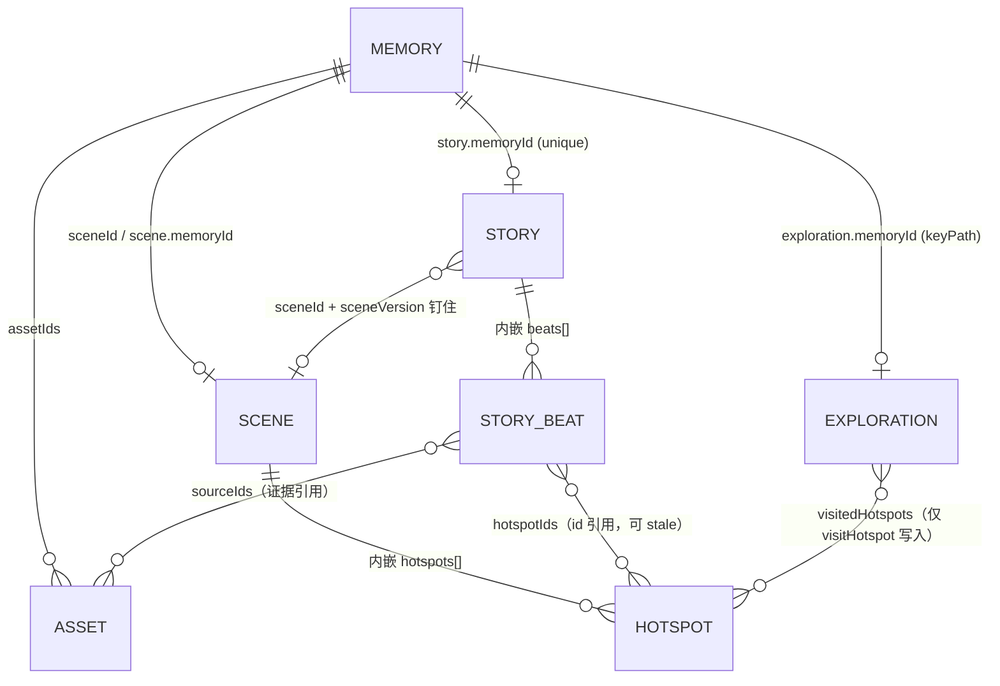

# 故事数据结构与 API v0.1 设计文档（定稿）

状态：**T7 汇总定稿，可直接作为实现阶段输入**。
输入：T1 `story-domain-model.md`、T2 `story-schema-design.md`、T3 `story-storage-design.md`、T4 `story-api-contract.md`、T5 `story-provider-design.md`、T6 `story-test-plan.md`，以及对 `src/schemas/*`、`src/services/*`、`src/lib/constants.js`、`tests/**` 的逐条源码核实（2026-11-17）。

**文档地位**：本文件是 Story 功能的唯一规范来源（single source of truth）。T1–T6 保留为过程记录与理由档案；凡措辞与本文件冲突，以本文件为准。冲突裁决记录见 §0.2。

---

## 0. 定稿说明

### 0.1 一句话架构

Story 是与 Memory 1:1 的持久化叙事实体（第五个 IndexedDB store）；叙事由 AI provider 经**无状态服务端路由**生成，浏览器是唯一持久化写入方；每个叙事节拍（beat）携带完整溯源五字段 + 审阅态，采纳门控下沉到 Zod schema，AI 推测永远无法被洗成已确认记忆。

### 0.2 T7 交叉评审裁决记录

以下各项是 T1–T6 之间经源码核实确认的不一致或缺口，本文档已裁决并落入正文。**实现时不再存在未决决策点。**

| # | 问题 | 裁决 | 落点 |
| --- | --- | --- | --- |
| J1 | T1 字段表 beat 用 `text`，与"复用 sourcedValueBaseSchema"矛盾 | 用 `value`（T2 D1 已修订 T1，语义不变） | §4 |
| J2 | T1 字段表 beats "1..MAX_BEATS, default []" 自相矛盾 | 必填、min(1)、无 default（T2 D4） | §4 |
| J3 | T1 字段表 beat id 标注 "UUID"，T5 D2 mock 用位置编号 | schema 只要求非空唯一字符串；实体级 id（story.id）才是仓库 stamped UUID；mock 用 `beat-1..n` 合法 | §4.1、§8.3 |
| J4 | **T6 S-F4 期望拒绝 `user_confirmed + confirmed + adopted + confidence<1`，但 T2 草案无此规则**（源码核实：`assertConfirmedProvenance` 只查 sourceType，全仓无 confidence 配对约束） | **新增 R5**：`user_confirmed ⇒ confidence === 1`，写入 `assertBeatAdoption`。理由与 R2 同源——beat 可被 patch 整组替换、不经服务层，手拼 patch 可造出"用户确认 20%"的矛盾展示态。所有合法路径（`adoptedBeatCopy`/`userConfirmedValue`/`confirmedCopy`）本就产出 confidence 1，T2 §4 全部合法样例不受影响。攻击样例表追加 A23 | §4.2、§4.5 |
| J5 | **T5 的 `asStoryError` 草案仿 `asSceneError` 只透传 MEMORY_NOT_FOUND，会把仓储的 STORAGE_FAILED / VALIDATION_FAILED 吞成 STORY_GENERATION_FAILED**；但 T4 L1 错误清单、T5 失败矩阵、T6 RB-8 三处都期望存储码原样浮现 | `asStoryError` **透传全部 StorageError**（`error instanceof StorageError ⇒ return error`）。这是对 asSceneError 的刻意偏离：story 编排是新代码，无兼容包袱，且三份文档的契约承诺一致指向透传。**asSceneError / asAiError 本身不改**（最小变更） | §7.2 |
| J6 | **`beats[].sourceIds ⊆ memory.assetIds` 校验无落点**：T1 §4.3 / T3 §6 声明为服务层义务，但 T2 §6、T4 §3.3、T5 编排均未指派，T6 无对应用例 | 归**客户端 generateStory**：draft 二次校验之后、落库之前检查；越界 → `STORY_INVALID_RESULT`，零写入。服务端无法做此检查（input 白名单刻意不含 assetIds）。MVP 内 sourceIds 只由 provider 产生（mock 恒 `[]`），编辑/采纳不改 sourceIds，故 patch 路径无需重复校验。失败矩阵与测试追加一行（RB-12） | §7.3、§10 |
| J7 | T4 L2 写"storySchema（读时校验）"，与 T3 及既有四仓储"写入时校验、读取原样返回"的惯例不符 | 读取**不做二次 parse**（与 memoryRepository.getById 等完全同型）；行合法性由写入点的全量 schema 校验保证。stale 派生不依赖 parse | §5.3、§7.5 |
| J8 | hotspot 子集校验与绑定抄写的归属在 T2（"服务层"）、T4（"路由侧"）、T5（客户端草案也做）之间措辞不一 | **双侧执行，非冲突**：服务端路由是权威网络边界（T4 §3.3）；客户端保留二次 draft 校验 + 子集校验 + 绑定抄写（AGENTS §3：服务端响应按不可信外部数据对待）。两侧各自完整成立，不依赖对端 | §6.3、§7.3 |
| J9 | T6 S-P5 写最小输入 `scene→[]` | 笔误。`storyGenerationInputSchema.scene` 为 `nullable().default(null)`，最小输入投影为 **null** | §10.2 |
| J10 | T6 §11 步骤 2 "25 例"、步骤 4 "22 例" 与 §1 分层表（L2=26、L5=20）不符 | 笔误。以分层表为准：L2=26、L5=20；另因 J6 追加 RB-12，L4=32，**总计 133 例** | §10.1 |
| J11 | T6 §12 "不持久化 Blob URL → R-U6、C-4、A-K4" 中 C-4 是重复删除用例，映射错误 | 更正为 R-U6、A-K4（另 S-B1 strict 拒绝未知字段） | §12 |
| J12 | T6 §11 实施顺序先写 L4（spyOn provider）再随 T4 换 fetch stub，L4 要写两遍 | 定稿顺序将**路由 + fetch 封装 + 编排合并为一批**，L4 直接用 fetch stub 写一次（T6 §9 本就建议 spyOn 改造与 T4 同批） | §11 |
| J13 | `listAiProviders()` 服务端化后的客户端形态未定 | 源码核实：**无任何 UI 调用方**（仅 aiService 导出 + 测试引用）。改为 async fetch E4 封装，保留导出名，仅测试改动 | §6.4 |
| J14 | T6 契约守卫 C-1/C-2 的比对对象是 T2/T4/T5 过程文档 | C-1 错误码表以**本文件 §3.3/§6.5/§7.6** 为比对源；C-2 夹具样例仍以 T2 §4 与 T5 §4（已实测产出）为单一来源，本文件 §4.4 原样收录合法样例 | §10.4 |

### 0.3 对 T1–T6 既有决策的确认（无变更）

- D1（T1）：Story ↔ Memory **1:1**，`stories.byMemoryId` 唯一索引强制；不做跨记忆聚合。
- D2（T1）：Story 是**持久化实体**，不是 facts 的派生视图；只存叙事与 id 引用，不复制 facts/hotspot/asset 数据体。
- D3（T1）：hotspot 用 **id 引用 + sceneVersion 钉住**；Exploration 经 memoryId 间接关联，Story 永不写 `visitedHotspots`。
- T3 §5：**不新增 memory.storyId 反向引用**（Exploration 模式）；将来若加，按 T3 §5.3 预留规则走 v3 迁移。
- T2 D3：采纳门控下沉 schema（R1–R4），比 analysisItemSchema 的服务层门控更严——差分事实已实测（A2 载荷在 analysisItemSchema 下通过、在 storyBeatSchema 下拒绝）。
- T2 D5：`storyBaseSchema`（纯 ZodObject）与 `storySchema`（ZodEffects）拆分，patch/draft 从 base 派生；跨字段不变量在仓储合并点强制。
- T4 D1：服务端只做无状态 AI 计算，浏览器唯一写入方；D2：URL 前缀 `/api/v0.1`，v0.1 内只增不改。
- T5 D4：**draft → 行投影**，`provider / simulated / generatedAt` 不落库（storySchema strict 兜底）。
- T5 D5：generateStory 成功**恢复 previousStatus**（ready/completed），不像 generateScene 强制 COMPLETED。
- T5 D3：Mock 透明性由开场 beat 的免责声明文本承载（story 行无 simulated 字段）。

---

## 1. MVP 范围与 AGENTS.md 红线自检

### 1.1 范围内

Memory 详情页内的故事生成 / 阅读 / 逐段编辑与采纳 / 热点跳转 / 重生成 / stale 提示；随 Memory 级联删除。

### 1.2 明确不做（§7 禁区 + §6 不提前实现）

跨 Memory 故事聚合、故事收藏/展馆、多身份叙事、AI 角色对话、社交分享、导出/备份、stories 的 byCreatedAt 索引与 list 接口、独立删除 UI、服务端持久化/会话态/job 队列、公网鉴权限流、跨标签页互斥（BroadcastChannel 等）。

### 1.3 红线逐条对照

| AGENTS 红线 | 本设计的强制点 |
| --- | --- |
| §3 AI 请求走服务端 API | E1–E3 路由承载全部 provider 调用；客户端 bundle 切断 providers/registry import（守卫 C-6） |
| §3 密钥不出浏览器 | 密钥仅服务端 `process.env`；禁 `NEXT_PUBLIC_`（守卫 C-6b）；响应仅 draft，无密钥/内部配置 |
| §3 Zod 校验外部数据 | 服务端响应在客户端落库前二次 `storyDraftSchema.parse`；input/output 双侧 strict |
| §3 场景生成与 React 解耦 | 生成编排在 aiService（服务层），UI 只消费 `{ memory, story }` 与错误码 |
| §4 UUID 实体 id | story.id 仓库 stamped `createId()`；beat id 为非空唯一字符串（J3） |
| §4 图片以 Blob 存 IndexedDB | 图片本体仍唯一存 `assets.blob`；story 行零 Blob |
| §4 不持久化 Blob URL | story 行仅文本 + id 引用；strict 拒绝 `blobUrl/coverBlobUrl` 等（R-U6 实测） |
| §4 保留实体关系 | memoryId 所有权外键 + 唯一索引；sceneId/sceneVersion 钉住；级联删除同事务 |
| §5 每项信息可溯源 | beat 强制溯源五字段 + baseline/adopted；R1–R5 门控；裸字符串拒绝 |
| §5 不虚构真实人物身份/关系 | input 白名单（无文件名/字节/未确认文本）；mock 收束段恒 fictional 且无人物事件；真实 provider prompt 同约束 |
| §6 最小变更 / 不新增依赖 | 变更面清单 §11.2；零新增 npm 依赖、零新增构建步骤 |
| §7 不提前实现未来特性 | §1.2 清单；registry 零改动、无能力描述符抽象 |

---

## 2. 领域模型与生命周期

### 2.1 关系图



### 2.2 生命周期（Story 无自有 status 字段）

由三个既有信号合成：Memory.status（门控与在途标记）、story 行是否存在、version/sceneVersion 比对（新鲜度，派生）。

| 阶段 | 判定 | 说明 |
| --- | --- | --- |
| 未生成 | stories 无行 | 入口仅在 `memory.status ∈ {ready, completed}` 可用 |
| 生成中 | `memory.status = generating` 且 inFlight 命中 | 复用 GENERATING 与同一 inFlight Set；故事/场景/整理三入口互斥 |
| 已生成 vN | story 行存在 | 失败恢复 previousStatus，不留半成品行 |
| 引用失效 stale | `scene.version ≠ story.sceneVersion`，或 scene 缺失/换 id，或 beat.hotspotIds 含不存在 id | **读取时派生，不落库、不抛错**；不阻塞纯文本阅读；无 STORY_STALE 错误码 |
| 已删除 | 随 Memory 级联 | MVP 无独立删除入口 |

协调要点：

- 生成门控与 generateScene 完全一致（aiService.js:297）：未确认的 draft 不得生成故事。
- 重生成原地更新：story.id 不变、version+1（与 scene 同策略）。
- **场景重生成不自动改写 Story**，只令其派生 stale，由用户决定重生成故事。
- 故事成功恢复 previousStatus（J/T5 D5）；场景成功置 COMPLETED 的既有语义不变。
- 生成期间 UI 禁用 story 编辑（重生成整组替换 beats，会覆盖在途编辑）；仓储层不硬阻并发本地写（IDB 事务串行化，见 §9.1 矩阵与 CX-10）。

---

## 3. 常量与错误码（constants.js 追加定稿）

### 3.1 存储与限额

```js
export const DB_VERSION = 2;                    // 1 → 2

export const STORES = { /* …既有四项… */ stories: "stories" };

export const INDEXES = {
  // …既有四项…
  stories: { byMemoryId: "memoryId" },          // unique: true 在迁移里声明
};

export const STORY_LIMITS = {
  MAX_BEATS: 12,
  MAX_BEAT_LENGTH: 1000,
};

export const STORY_INITIAL_VERSION = 1;
```

- `hotspotIds` 上限复用 `SCENE_LIMITS.MAX_HOTSPOTS`（24）；title 上限沿用既有 120 字面量；objects 单项上限复用 `ANALYSIS_LIMITS.MAX_ITEM_LENGTH`（80）。
- 不新增 SOURCE_TYPES、不新增 MEMORY_STATUS 值、不新增 status 枚举。

### 3.2 新增错误码（六个，与 SCENE_* 同型）

```js
STORY_NOT_FOUND: "STORY_NOT_FOUND",
STORY_ALREADY_EXISTS: "STORY_ALREADY_EXISTS",
STORY_NOT_CONFIRMED: "STORY_NOT_CONFIRMED",
STORY_GENERATION_IN_PROGRESS: "STORY_GENERATION_IN_PROGRESS",
STORY_GENERATION_FAILED: "STORY_GENERATION_FAILED",
STORY_INVALID_RESULT: "STORY_INVALID_RESULT",
```

不新增其他码：输入校验复用 `VALIDATION_FAILED / AI_INVALID_INPUT`；provider 缺失复用 `AI_PROVIDER_UNAVAILABLE`；stale 是派生态不是错误。UI 文案字典按既有 `ERROR_CODES → 中文文案` 模式追加六条。

### 3.3 错误码全集与触发侧（守卫 C-1 的比对源）

**服务端发出（9 个，HTTP 映射见 §6.5）**：VALIDATION_FAILED、AI_INVALID_INPUT、AI_PROVIDER_UNAVAILABLE、AI_INVALID_RESULT、AI_ANALYSIS_FAILED、SCENE_INVALID_RESULT、SCENE_GENERATION_FAILED、STORY_INVALID_RESULT、STORY_GENERATION_FAILED。

**本地发出（24 个，永不走网络）**：

| 组 | 码 | 触发侧 |
| --- | --- | --- |
| 404 语义 | MEMORY_NOT_FOUND / ASSET_NOT_FOUND / SCENE_NOT_FOUND / STORY_NOT_FOUND / EXPLORATION_NOT_FOUND / AI_ANALYSIS_NOT_FOUND | 本地 repository/service |
| 409 语义 | SCENE_ALREADY_EXISTS / STORY_ALREADY_EXISTS / EXPLORATION_ALREADY_EXISTS | 唯一索引/所有权检查 |
| 409 语义 | AI_ANALYSIS_IN_PROGRESS / SCENE_GENERATION_IN_PROGRESS / STORY_GENERATION_IN_PROGRESS | 客户端 inFlight |
| 409 语义 | SCENE_NOT_CONFIRMED / STORY_NOT_CONFIRMED | 客户端门控，**发起 HTTP 前**拦截 |
| 400 语义 | VALIDATION_FAILED | 本地 Zod / visitHotspot 热点不存在 |
| 500 语义 | STORAGE_FAILED | IDB 事务失败 |
| 503 语义 | STORAGE_UNAVAILABLE | 浏览器无 IndexedDB |
| 导入 reasonCode | FILE_TOO_LARGE / FILE_EMPTY / UNSUPPORTED_FILE_TYPE / CORRUPTED_IMAGE / TOO_MANY_IMAGES / DUPLICATE_IMAGE / IMAGES_REQUIRED | 本地导入校验（v0.1 无上传端点） |

---

## 4. Zod Schema（src/schemas/storySchema.js 定稿草案）

### 4.1 字段表

**Story**（stories store，keyPath `id`，`.strict()`）：

| 字段 | 类型 / 约束 | 默认 | 说明 |
| --- | --- | --- | --- |
| id | string，min(1)，仓库 stamped UUID | — | 实体主键 |
| memoryId | string，min(1) | 必填 | 所有权外键，创建后不可变（patch omit） |
| sceneId | string min(1)，nullable | null | 生成时绑定的场景 |
| sceneVersion | int positive，nullable | null | 与 sceneId 成对（superRefine） |
| title | string，trim，1..120 | 必填 | 故事标题 |
| beats | storyBeatSchema 数组，**必填 1..12**，id 唯一 | 无 default | 数组顺序即阅读顺序 |
| version | int positive | 1 | 重生成递增，id 不变 |
| createdAt / updatedAt | int 非负 | 仓库 stamped | |

**StoryBeat**（内嵌，不独立建 store；`sourcedValueBaseSchema.extend` 构造，与 analysisItemSchema 同型）：

| 字段 | 类型 / 约束 | 默认 | 说明 |
| --- | --- | --- | --- |
| id | string，min(1)，组内唯一 | 必填 | 非空唯一字符串即可（J3）；mock 用位置编号 |
| value | string，trim，1..1000 | 必填 | **叙事段落文本**（J1：不叫 text） |
| baseline | string，trim，1..1000 | 必填 | provider 原始措辞；用户编辑落在 value |
| sourceType | sourceTypeSchema | 必填 | 溯源类别 |
| sourceIds | string 数组（asset id） | [] | 证据引用；⊆ memory.assetIds（服务层校验，J6） |
| confidence | number 0..1 | 0 | user_confirmed 时恒 1（R5） |
| confirmed | boolean | false | R1 约束 |
| adopted | boolean | false | 用户采纳标记；R2/R3 约束 |
| hotspotIds | string 数组，≤24，去重 | [] | 仅 sceneId 非 null 时允许非空 |

### 4.2 溯源门控规则（schema 层强制）

| 规则 | 内容 | 杀死的攻击 |
| --- | --- | --- |
| R1（继承 assertConfirmedProvenance） | `confirmed: true ⇒ sourceType = user_confirmed` | AI 推测/想象直接标 confirmed |
| R2 | `sourceType = user_confirmed ⇒ adopted: true 且 confirmed: true` | AI 段落重新 POST 成"已确认事实"（核心攻击 A2） |
| R3 | `adopted: true ⇒ sourceType ∈ {user_confirmed, fictional}` | "采纳了但仍标 AI 推测"的歧义态 |
| R4（draft 专属） | draft beat 的 sourceType 只许 `ai_inferred \| fictional`，adopted 只许 `false` | provider 冒充确认 / 预采纳 |
| **R5（T7 新增，J4）** | `sourceType = user_confirmed ⇒ confidence === 1` | 手拼 patch 造出"用户确认 20%"矛盾态 |

fictional 的采纳（R3 放行）保持 `fictional / confirmed: false`：采纳想象段 ≠ 把想象洗成确认记忆。

### 4.3 完整代码草案（含 R5；其余与 T2 已实测草案一致）

```js
import { z } from "zod";

import {
  AI_PROVIDERS,
  ANALYSIS_LIMITS,
  SCENE_LIMITS,
  SCENE_TYPE_LIST,
  SOURCE_TYPES,
  STORY_INITIAL_VERSION,
  STORY_LIMITS,
} from "@/lib/constants";
import {
  assertConfirmedProvenance,
  sourceTypeSchema,
  sourcedValueBaseSchema,
} from "@/schemas/sourceSchema";

const { MAX_BEATS, MAX_BEAT_LENGTH } = STORY_LIMITS;

const beatText = z.string().trim().min(1).max(MAX_BEAT_LENGTH);

const hotspotIdListSchema = z
  .array(z.string().min(1))
  .max(SCENE_LIMITS.MAX_HOTSPOTS)
  .default([])
  .superRefine((ids, ctx) => {
    const seen = new Set();
    ids.forEach((id, index) => {
      if (seen.has(id)) {
        ctx.addIssue({
          code: z.ZodIssueCode.custom,
          message: `Duplicate hotspot id: ${id}`,
          path: [index],
        });
      }
      seen.add(id);
    });
  });

// Narrative is AI-authored first, so user_confirmed is only reachable through
// adoption. The gate lives in the schema because story patches replace beats
// without passing a review service.
function assertBeatAdoption(beat, ctx) {
  if (beat.sourceType === SOURCE_TYPES.USER_CONFIRMED && (!beat.adopted || !beat.confirmed)) {
    ctx.addIssue({
      code: z.ZodIssueCode.custom,
      message: "A user_confirmed beat must be adopted and confirmed",
      path: ["adopted"],
    });
  }
  // R5 (T7/J4): every legitimate confirmation path stamps confidence 1; a
  // hand-built patch must not display "user confirmed, 20% sure".
  if (beat.sourceType === SOURCE_TYPES.USER_CONFIRMED && beat.confidence !== 1) {
    ctx.addIssue({
      code: z.ZodIssueCode.custom,
      message: "A user_confirmed beat must carry confidence 1",
      path: ["confidence"],
    });
  }
  if (
    beat.adopted &&
    beat.sourceType !== SOURCE_TYPES.USER_CONFIRMED &&
    beat.sourceType !== SOURCE_TYPES.FICTIONAL
  ) {
    ctx.addIssue({
      code: z.ZodIssueCode.custom,
      message: "Only user_confirmed or fictional beats may be adopted",
      path: ["sourceType"],
    });
  }
}

function buildStoryBeat({ sourceType, adopted }) {
  return sourcedValueBaseSchema
    .extend({
      id: z.string().min(1),
      value: beatText,
      // The untouched provider wording; user edits land in value (same contract
      // as analysisItemSchema.baseline).
      baseline: beatText,
      sourceType,
      adopted,
      hotspotIds: hotspotIdListSchema,
    })
    .superRefine(assertConfirmedProvenance)
    .superRefine(assertBeatAdoption);
}

export const storyBeatSchema = buildStoryBeat({
  sourceType: sourceTypeSchema,
  adopted: z.boolean().default(false),
});

// Provider output can never claim confirmation or adoption: story regeneration
// has no "match an existing confirmed value" merge, adoption is a user act.
const storyDraftBeatSchema = buildStoryBeat({
  sourceType: z.enum([SOURCE_TYPES.AI_INFERRED, SOURCE_TYPES.FICTIONAL]),
  adopted: z.literal(false).default(false),
});

function buildBeatList(beatSchema) {
  return z
    .array(beatSchema)
    .min(1)
    .max(MAX_BEATS)
    .superRefine((beats, ctx) => {
      const seen = new Set();
      beats.forEach((beat, index) => {
        if (seen.has(beat.id)) {
          ctx.addIssue({
            code: z.ZodIssueCode.custom,
            message: `Duplicate beat id: ${beat.id}`,
            path: [index, "id"],
          });
        }
        seen.add(beat.id);
      });
    });
}

const storyFields = {
  memoryId: z.string().min(1),
  sceneId: z.string().min(1).nullable().default(null),
  sceneVersion: z.number().int().positive().nullable().default(null),
  title: z.string().trim().min(1).max(120),
  version: z.number().int().positive().default(STORY_INITIAL_VERSION),
};

function assertSceneBinding(story, ctx) {
  if ((story.sceneId === null) !== (story.sceneVersion === null)) {
    ctx.addIssue({
      code: z.ZodIssueCode.custom,
      message: "sceneId and sceneVersion must be set together",
      path: ["sceneVersion"],
    });
  }
  if (story.sceneId === null) {
    story.beats.forEach((beat, index) => {
      if (beat.hotspotIds.length > 0) {
        ctx.addIssue({
          code: z.ZodIssueCode.custom,
          message: "hotspotIds require a bound scene",
          path: ["beats", index, "hotspotIds"],
        });
      }
    });
  }
}

// Plain ZodObject so patch/draft can use omit/extend; the cross-field refine
// would turn it into ZodEffects and break derivation.
const storyBaseSchema = z
  .object({
    id: z.string().min(1),
    ...storyFields,
    beats: buildBeatList(storyBeatSchema),
    createdAt: z.number().int().nonnegative(),
    updatedAt: z.number().int().nonnegative(),
  })
  .strict();

export const storySchema = storyBaseSchema.superRefine(assertSceneBinding);

// memoryId is the ownership link and stays fixed after creation. Cross-field
// invariants are enforced by the repository's merged full-schema validation
// (same pattern as sceneRepository.update), not by the partial patch.
export const storyPatchSchema = storyBaseSchema
  .omit({ id: true, memoryId: true, createdAt: true })
  .partial();

// The provider's output before the repository stamps id and timestamps.
export const storyDraftSchema = storyBaseSchema
  .omit({ id: true, createdAt: true, updatedAt: true })
  .extend({
    provider: z.enum(Object.values(AI_PROVIDERS)),
    simulated: z.literal(true),
    generatedAt: z.number().int().nonnegative(),
    beats: buildBeatList(storyDraftBeatSchema),
  })
  .superRefine(assertSceneBinding);

// What the story provider is allowed to see: the user's own title, the objects
// they confirmed, a classification label, and the hotspot ids/names it may bind
// beats to. No file names, no image bytes, no unconfirmed facts, no description.
export const storyGenerationInputSchema = z
  .object({
    memoryId: z.string().min(1),
    title: z.string().trim().min(1).max(120),
    sceneType: z.enum(SCENE_TYPE_LIST).nullable().default(null),
    objects: z
      .array(z.string().trim().min(1).max(ANALYSIS_LIMITS.MAX_ITEM_LENGTH))
      .max(SCENE_LIMITS.MAX_HOTSPOTS)
      .default([]),
    imageCount: z.number().int().nonnegative(),
    scene: z
      .object({
        id: z.string().min(1),
        version: z.number().int().positive(),
        hotspots: z
          .array(
            z
              .object({
                id: z.string().min(1),
                name: z.string().trim().min(1).max(120),
              })
              .strict(),
          )
          .max(SCENE_LIMITS.MAX_HOTSPOTS)
          .default([]),
      })
      .strict()
      .nullable()
      .default(null),
  })
  .strict();

// Beat-level counterpart of confirmedCopy: adoption keeps beat identity and
// review state (beats never leave the story into facts, so no projection onto
// bare five fields). Fictional beats stay fictional forever: adopting an
// imaginative paragraph never launders it into a confirmed memory.
export function adoptedBeatCopy(beat, editedValue = beat.value) {
  const fictional = beat.sourceType === SOURCE_TYPES.FICTIONAL;
  return {
    ...beat,
    value: editedValue,
    sourceType: fictional ? SOURCE_TYPES.FICTIONAL : SOURCE_TYPES.USER_CONFIRMED,
    confidence: fictional ? beat.confidence : 1,
    confirmed: !fictional,
    adopted: true,
  };
}
```

实现注意：

- `storySchema` 是 ZodEffects（顶层 superRefine），**不可**再 `.omit/.partial`；一切派生走 `storyBaseSchema`（T2 D5，Zod 3 陷阱）。
- patch 单独看允许半对字段（如只给 sceneVersion）——这不是漏洞：仓储 update 合并已有行后必走完整 storySchema，跨字段不变量在合并点强制（与 sceneRepository.update 同型）。
- beat 级编辑 = beats **整组替换**（同 memory facts 的 patch 方式），不存在半条 beat。
- 采纳路径统一走 `adoptedBeatCopy`（可 grep，同 userConfirmedValue 的设计动机），UI 不得手拼溯源字段（守卫 C-5）。
- R5 为 T7 新增：T2 临时套件未覆盖此规则，实现时 L1 的 S-F4/A23 用例必须第一批落地验证。

### 4.4 合法样例（= 测试夹具单一来源，与 T2 §4 一致）

**最小持久化故事（无场景）**：

```js
{
  id: "story-1", memoryId: "memory-1", sceneId: null, sceneVersion: null,
  title: "食堂的中午",
  beats: [{
    id: "beat-1",
    value: "中午的食堂很热闹，餐盘碰撞声此起彼伏。",
    baseline: "中午的食堂很热闹，餐盘碰撞声此起彼伏。",
    sourceType: "ai_inferred", sourceIds: ["asset-1"],
    confidence: 0.4, confirmed: false, adopted: false, hotspotIds: [],
  }],
  version: 1, createdAt: 1700000000000, updatedAt: 1700000000000,
}
```

**绑定场景 + 已采纳编辑段 + 想象段**：

```js
{
  id: "story-2", memoryId: "memory-1", sceneId: "scene-1", sceneVersion: 2,
  title: "食堂的中午",
  beats: [
    {
      id: "beat-1",
      value: "我们常坐靠窗的那排位置，阳光正好落在餐盘上。", // 用户编辑
      baseline: "食堂里有靠窗的座位。",                        // provider 原文
      sourceType: "user_confirmed", sourceIds: ["asset-1"],
      confidence: 1, confirmed: true, adopted: true,
      hotspotIds: ["hotspot-1", "hotspot-2"],
    },
    {
      id: "beat-2",
      value: "也许那天窗外飘着一点雨丝。",
      baseline: "也许那天窗外飘着一点雨丝。",
      sourceType: "fictional", sourceIds: [],
      confidence: 0.2, confirmed: false, adopted: true, // 采纳想象段仍是 fictional
      hotspotIds: [],
    },
  ],
  version: 3, createdAt: 1700000000000, updatedAt: 1700000009000,
}
```

**provider draft（省略字段走 default）**：

```js
{
  provider: "mock", simulated: true, generatedAt: 1700000000000,
  memoryId: "memory-1", sceneId: "scene-1", sceneVersion: 2,
  title: "食堂的中午",
  // version 缺省 → 1；beat 的 sourceIds/confidence/confirmed/adopted/hotspotIds
  // 缺省 → []/0/false/false/[]
  beats: [{
    id: "beat-1", value: "中午的食堂很热闹。", baseline: "中午的食堂很热闹。",
    sourceType: "ai_inferred", hotspotIds: ["hotspot-1"],
  }],
}
```

**生成输入（完整 / 最小）**：

```js
{
  memoryId: "memory-1", title: "食堂的中午", sceneType: "cafeteria",
  objects: ["餐盘", "餐桌"], imageCount: 2,
  scene: {
    id: "scene-1", version: 2,
    hotspots: [{ id: "hotspot-1", name: "餐盘" }, { id: "hotspot-2", name: "餐桌" }],
  },
}
// 最小输入：{ memoryId: "memory-1", title: "空白", imageCount: 0 }
// → sceneType: null, objects: [], scene: null（J9：不是 []）
```

**patch 样例**：`{ title: "新的标题" }`；`{ beats: [/* 整组 */] }`；`{ sceneId: null, sceneVersion: null }`；`{ version: 4 }`。

### 4.5 非法样例（攻击表 A1–A23；夹具集中在 tests/helpers/storyData.js 的 STORY_ATTACKS）

| # | 载荷（相对合法基线的改动） | 拒绝于 | 命中规则 |
| --- | --- | --- | --- |
| A1 | beat `ai_inferred + confirmed:true` | storySchema / storyDraftSchema | R1 |
| A2 | **核心攻击**：beat `user_confirmed + confirmed:true + adopted:false`（AI 原文重新 POST 成确认事实） | storySchema / storyPatchSchema.beats | R2 |
| A3 | A2 变体 `adopted:true + confirmed:false` | storySchema | R2 |
| A4 | `beats: ["从前有一个食堂…"]` 裸字符串 | storySchema | 五字段强制 |
| A5 | beat 只有 `{ id, value }`，缺 sourceType | storySchema | sourceType 必填 |
| A6 | draft beat `user_confirmed + confirmed:true + adopted:true` | storyDraftSchema | R4 enum |
| A7 | draft beat `adopted:true` | storyDraftSchema | R4 literal(false) |
| A8 | draft `simulated:false` | storyDraftSchema | literal(true) |
| A9 | `sceneId:null` 但 beat 带 hotspotIds | storySchema / storyDraftSchema | assertSceneBinding |
| A10 | `sceneId:"scene-1", sceneVersion:null` 半对绑定 | storySchema / storyDraftSchema | assertSceneBinding |
| A11 | 两个 beat 同 id | storySchema | beat id 唯一 |
| A12 | beat 内 `hotspotIds:["h1","h1"]` | storySchema | hotspotId 去重 |
| A13 | patch 含 `memoryId / id / createdAt` | storyPatchSchema | omit + strict |
| A14 | story 含 `status:"published"`；beat 含 `secret:1` | storySchema | strict |
| A15 | `beats: []` | storySchema / storyDraftSchema | min(1) |
| A16 | beat `confidence:1.5` | storySchema | 0..1 |
| A17 | beat `ai_inferred + adopted:true` | storySchema | R3 |
| A18 | beat `fictional + confirmed:true` | storySchema | R1 |
| A19 | beat `sourceType:"guessed"` | storySchema | sourceType enum |
| A20 | beat value 超 1000 字 / 空串 | storySchema | beatText |
| A21 | 输入含 `originalName:"mum.jpg"` / hotspots 条目含 `blob` | storyGenerationInputSchema | strict（provider 边界） |
| A22 | 输入 `scene:{id:"scene-1"}` 缺 version | storyGenerationInputSchema | version 必填 |
| **A23** | **beat `user_confirmed + confirmed:true + adopted:true + confidence:0.5`（T7 新增）** | storySchema / storyPatchSchema.beats | **R5** |

边界说明：patch `{ sceneVersion: 2 }` 单独通过 storyPatchSchema（partial 允许半对），仓储合并已有行（sceneId:null）后走完整 storySchema 时被 A10 同规则拒绝。差分对照（S-F13）：A2 载荷在 analysisItemSchema 下**通过**（其门控在 confirmAnalysis 服务层）、在 storyBeatSchema 下**拒绝**——已实测，实现后必须保持。

---

## 5. 存储与迁移

### 5.1 stories store

| 项 | 值 |
| --- | --- |
| store 名 | `stories`（第五个 object store） |
| keyPath | `id` |
| 索引 | `byMemoryId → "memoryId"`，`unique: true`（数据库层强制 1:1） |
| 其他索引 | 无（不建 byCreatedAt，将来需要走新版本迁移） |

行内容 = storySchema parse 产物：纯文本 + id 引用，**不含 Blob / Blob URL / 图片字节 / provider 元数据**。

### 5.2 DB_VERSION 1 → 2 迁移（db.js 追加，永不改动条目 1）

```js
const migrations = {
  1: (db) => { /* 已发布，原样保留 */ },
  2: (db) => {
    const stories = db.createObjectStore(STORES.stories, { keyPath: "id" });
    stories.createIndex(INDEXES.stories.byMemoryId, "memoryId", { unique: true });
  },
};
```

- **纯结构追加，零数据变换**：老用户升级（oldVersion 1）只跑条目 2，四个既有 store 一个字节不动；全新安装（oldVersion 0）顺序跑 1→2。
- upgrade 跑在 versionchange 事务里：条目 2 抛错 → 整体 abort，DB 停留 v1 且数据完好；`getDB` 的 catch 已置空 dbPromise，下次重试。
- 多标签页 blocked/blocking 让位机制原样复用（db.js:101-106），不新增代码。
- 不做数据回填、不做降级迁移、不在迁移里写业务数据。

### 5.3 StoryRepository（新文件 src/services/storage/storyRepository.js，同构 sceneRepository，但不回写 Memory）

`LINKED_STORES = [STORES.stories, STORES.memories]`。

| 接口 | 行为 | 错误码 |
| --- | --- | --- |
| `create(input)` | `validate(storySchema, { ...input, id: createId(), createdAt/updatedAt: now() })`；`[stories, memories]` 事务内：memory 不存在 → MEMORY_NOT_FOUND；`stories.index(byMemoryId).get` 已存在 → STORY_ALREADY_EXISTS；`put(record)`。**memories 只读校验，不写 memory 行**。唯一索引硬兜底竞态（ConstraintError → STORAGE_FAILED，事务 abort） | MEMORY_NOT_FOUND / STORY_ALREADY_EXISTS / VALIDATION_FAILED / STORAGE_FAILED |
| `getById(storyId)` | `readFrom` get，缺失返回 null。**读取不做二次 parse**（J7，与既有仓储同型） | STORAGE_FAILED |
| `getByMemoryId(memoryId)` | 唯一索引 `index.get`，至多一行；UI 读取主路径 | STORAGE_FAILED |
| `update(storyId, patch)` | `definedOnly(validate(storyPatchSchema, patch))`；事务只含 stories；get 缺失 → STORY_NOT_FOUND；合并 `{ ...existing, ...cleanPatch, id/memoryId/createdAt: existing 原值, updatedAt: now() }` 后**完整 storySchema 二次校验**再 put（跨字段不变量与 R1–R5 在合并点强制）。**version 递增由服务层写入 patch，仓库不自动递增** | STORY_NOT_FOUND / VALIDATION_FAILED / STORAGE_FAILED |
| `delete(storyId)` | 事务只含 stories；缺失 → STORY_NOT_FOUND。为接口完整性而设，MVP 服务层不暴露；**Memory 级联不经过本方法**（跨 Repository 会开第二个事务） | STORY_NOT_FOUND / STORAGE_FAILED |

### 5.4 Memory 删除级联（memoryRepository.js 两处最小改动）

```js
const CASCADE_STORES = [
  STORES.memories, STORES.assets, STORES.scenes, STORES.explorations,
  STORES.stories,                                   // 追加
];

// delete 事务内，explorations.delete 之后追加一行：
await deleteByIndex(tx, STORES.stories, INDEXES.stories.byMemoryId, memoryId);
```

同一 readwrite 事务、同一 deleteByIndex 工具、同样的前置校验与整体回滚语义。场景单独删除/重生成**不**级联动 story（只派生 stale）。

### 5.5 不新增 memory.storyId 反向引用（T3 §5 决策，确认）

Story 跟随 Exploration 模式（1:1 子实体、无父侧反向引用、按 memoryId 直查）。理由：查询无增益（主路径本就是唯一索引 get）、保住纯结构迁移（避免全表回填）、不越出 T1 变更面、免除双写同步、有 Exploration 先例。将来若列表页确需"含故事"徽标，按 T3 §5.3 预留规则升级（patch omit + 同事务双写 + v3 回填迁移）。

### 5.6 回滚策略（三层）

| 层 | 场景 | 策略 | 数据后果 |
| --- | --- | --- | --- |
| L1 自动 | migration 2 失败 | versionchange abort，DB 停留 v1，下次 getDB 重试 | 零损失 |
| L2 代码回滚 | 撤销 Story 功能 | **DB_VERSION 保持 2、保留 migrations[2] 与 STORES/INDEXES.stories 及级联行**，只撤业务代码 | 既有四 store 不受影响；stories 空转或 inert |
| L3 彻底重置 | 开发脏库/用户明确放弃数据 | closeDB 后 deleteDatabase 重建 | **销毁全部本地记忆，不可逆**；绝不进入自动流程 |

禁止：把 DB_VERSION 改回 1 发布（老用户 VersionError）；编辑已发布的 migrations[1]。

---

## 6. 服务端 API 契约（/api/v0.1）

### 6.1 边界决策（T4 D1，确认）

**服务端只做无状态 AI 计算；浏览器是唯一持久化写入方。**

| 职责 | 归属 |
| --- | --- |
| provider registry / 密钥 / AI 调用 | 服务端路由 `src/app/api/v0.1/ai/*/route.js` |
| input 构造（facts 投影、scene 绑定块） | 客户端 aiService |
| 生成门控（status ∈ ready/completed）、inFlight | 客户端 aiService，发起 HTTP 前 |
| draft 校验 | **两侧**：服务端校验 provider 原始输出；客户端校验注入/合并后的 draft |
| revision / version / id / 时间戳注入 | 客户端 aiService + Repository stamped |
| 审阅合并、确认/采纳投影 | 客户端（mergeWithPreviousDraft / confirmedCopy / adoptedBeatCopy） |
| 全部持久化与级联删除 | 客户端 Repository + IndexedDB 事务 |
| stale 派生 | 客户端视图层，不落库 |

密钥隔离硬约束：密钥只经服务端 `process.env`；禁 `NEXT_PUBLIC_` 承载密钥；客户端 bundle 不得 import `providers/*` 与 registry 实例（现有 aiService.js:16-18 的 mockProvider import 必须切断）；请求体永不含 Blob/文件名/图片字节；响应体永不含密钥与内部配置；`simulated: z.literal(true)` 徽标契约不变（接真实 provider 时双侧同步放宽）。

### 6.2 版本化（T4 D2，确认）

URL 前缀 `/api/v0.1`；v0.1 内只增不改（新端点/新错误码/响应新增可选字段为非破坏）；破坏性变更 → `/api/v0.2`，旧前缀保留至迁移完成。API 版本与 DB_VERSION 相互独立。

### 6.3 端点表（全部无状态）

通用约定：请求 `Content-Type: application/json`；可选 header `X-AI-Provider: <name>`，缺省用服务端 `DEFAULT_AI_PROVIDER`；**provider 选择不进请求体**（三个 input schema 均 strict）。成功 200；失败统一错误信封（§6.5）。无认证（单用户本地应用、同源调用；公网鉴权限流属未来任务）。生成类 POST **非幂等**，客户端不自动重试。

| # | 方法 | 路径 | 请求体 | 成功响应 | 替代的现有调用 |
| --- | --- | --- | --- | --- | --- |
| E1 | POST | `/api/v0.1/ai/analyze` | analysisInputSchema | `{ draft: analysisDraftSchema }` | `provider.analyze(input)` |
| E2 | POST | `/api/v0.1/ai/scene` | sceneGenerationInputSchema | `{ draft: sceneDraftSchema }` | `provider.buildScene(input)` |
| E3 | POST | `/api/v0.1/ai/story` | storyGenerationInputSchema | `{ draft: storyDraftSchema }` | 新增 `provider.buildStory(input)` |
| E4 | GET | `/api/v0.1/ai/providers` | 无 | `{ providers: string[], defaultProvider: string }` | `listAiProviders()` |

**E3 服务端义务（顺序固定）**：

1. `storyGenerationInputSchema.parse(body)`（JSON 解析失败 / parse 失败 → VALIDATION_FAILED 400）。
2. `registry.get(header ?? DEFAULT_AI_PROVIDER)`；provider 不存在或缺 `buildStory` → AI_PROVIDER_UNAVAILABLE 400（**调用点能力检查，registry 零改动**，T5 D1）。
3. `provider.buildStory(input)`。
4. **绑定抄写**：用 `input.scene` 覆写 draft 的 `sceneId / sceneVersion`（scene 为 null 则双 null），provider 不得自造绑定。
5. `storyDraftSchema.parse` → 失败 STORY_INVALID_RESULT 502（R4 在此拦截 provider 冒充确认/预采纳）。
6. **越界校验**：每个 beat 的 `hotspotIds ⊆ input.scene.hotspots[].id`，越界 → STORY_INVALID_RESULT 502。
7. 返回 `{ draft }`。draft 永不含 `id / createdAt / updatedAt`；`version` 可省略（default 1），`revision`（E1）同理。

E1/E2 同型：input parse → registry → provider → draft schema parse；**revision 注入与 mergeWithPreviousDraft 仍在客户端**（合并需要本地上一版 draft，服务端无从得知）。

**字段注入责任表（draft → 持久化行）**：

| 字段 | 注入方 | 规则 |
| --- | --- | --- |
| analysis.revision | 客户端 aiService | previous + 1（既有） |
| scene.version / story.version | 客户端 aiService | existing + 1，否则 INITIAL_VERSION |
| scene.memoryId / story.memoryId | 客户端 aiService | 以本地 memory.id 覆写 |
| story.sceneId / sceneVersion | 服务端抄写 + 客户端二次抄写校验 | 从 input.scene（J8 双侧） |
| id / createdAt / updatedAt | 客户端 Repository | stamped，服务端响应永不含 |
| beat 采纳字段 | 客户端 adoptedBeatCopy | 唯一可 grep 入口，不经网络 |
| **provider / simulated / generatedAt** | **客户端投影时丢弃（T5 D4）** | draft 元数据不落库，storySchema strict 兜底 |

### 6.4 客户端 fetch 封装与 listAiProviders

```js
// aiService 内部；三个生成入口共用。错误信封还原为 AiError，UI 文案字典零改动。
async function requestAiDraft(path, input, providerName) {
  const response = await fetch(`/api/v0.1/ai/${path}`, {
    method: "POST",
    headers: {
      "Content-Type": "application/json",
      ...(providerName ? { "X-AI-Provider": providerName } : {}),
    },
    body: JSON.stringify(input),
  });

  if (!response.ok) {
    let envelope = null;
    try { envelope = await response.json(); } catch { /* 无信封 */ }
    const code = envelope?.error?.code;
    if (code && ERROR_CODES[code]) {
      throw new AiError(code, envelope.error.message);
    }
    // 无信封的非 2xx（框架级 404/405 等）：抛普通 Error，
    // 由各入口的 asXxxError 兜底为对应域的 *_GENERATION_FAILED / AI_ANALYSIS_FAILED。
    throw new Error(`AI request failed with status ${response.status}`);
  }

  const { draft } = await response.json();
  return draft;
}
```

- `generateStory(memoryId, { providerName } = {})`：providerName 可选；缺省**不发 header**，由服务端 default 决定（J14 相关）。
- `listAiProviders()` 改为 **async fetch E4 封装**，保留导出名（J13：无 UI 调用方，仅测试改动）；registry 是服务端事实，客户端不再维护 provider 名单。
- registry 实例移至**仅服务端引用的新模块**（建议 `src/services/ai/server/registry.js`，由四个路由 import）；`aiProvider.js` 的 `AiError` 类仍共享（客户端信封还原用），`createProviderRegistry` 零改动。

### 6.5 错误信封与 HTTP 映射

所有非 2xx 服务端响应：

```json
{ "error": { "code": "STORY_INVALID_RESULT", "message": "故事结果不符合约定的数据结构" } }
```

`code ∈ ERROR_CODES`，`message` 为中文用户文案。框架级 404/405 不带信封，客户端封装兜底（§6.4）。

| 错误码 | HTTP | 触发路径 |
| --- | --- | --- |
| VALIDATION_FAILED | 400 | 请求体 JSON 解析失败 / input schema parse 失败 |
| AI_INVALID_INPUT | 400 | provider 入口重 parse 输入失败（防御纵深） |
| AI_PROVIDER_UNAVAILABLE | 400 | X-AI-Provider 未注册，或缺 analyze/buildScene/buildStory（客户端可改选，故 4xx） |
| AI_INVALID_RESULT | 502 | analyze 输出不合 analysisDraftSchema |
| AI_ANALYSIS_FAILED | 502 | analyze 兜底 |
| SCENE_INVALID_RESULT | 502 | scene 输出不合 sceneDraftSchema |
| SCENE_GENERATION_FAILED | 502 | scene 兜底 |
| STORY_INVALID_RESULT | 502 | story 输出不合 storyDraftSchema，或 hotspotIds 越界 |
| STORY_GENERATION_FAILED | 502 | story 兜底 |

映射原则：**请求可修复 → 4xx；上游 provider 产出不可信/失败 → 502**。路由内未知异常经 `asStoryError` 同型归一化（§7.2），**不允许裸 Error 逃出路由**。路由只导出声明过的动词（测试 A-E10 断言其余动词 undefined）。

---

## 7. 客户端编排与本地操作

### 7.1 本地操作契约表（无 HTTP；契约由 schema + 错误码表达）

| # | 操作 | 入口 | 校验 | 错误码 |
| --- | --- | --- | --- | --- |
| L1 | story 生成编排 | `aiService.generateStory(memoryId, { providerName })`（新增） | 门控 + input/draft schema + 子集校验 | MEMORY_NOT_FOUND / STORY_NOT_CONFIRMED / STORY_GENERATION_IN_PROGRESS / AI_PROVIDER_UNAVAILABLE / STORY_INVALID_RESULT / STORY_GENERATION_FAILED / STORAGE_FAILED / VALIDATION_FAILED |
| L2 | story 读取 | `StoryRepository.getByMemoryId`；视图 `aiService.readStory`（§7.5） | 写入时已校验，读取原样返回（J7） | STORAGE_FAILED；无行返回 null，**不是错误** |
| L3 | story 更新（标题/编辑段落） | `StoryRepository.update(id, patch)` | storyPatchSchema → 合并后完整 storySchema | STORY_NOT_FOUND / VALIDATION_FAILED / STORAGE_FAILED |
| L4 | story "确认" = beat 采纳 | UI 调 `adoptedBeatCopy(beat, editedValue)` 后走 L3 整组替换 beats | R2/R3/R5 门控 | VALIDATION_FAILED（A2/A3/A17/A18/A23 路径） |
| L5 | story 删除 | 无独立入口；随 Memory 级联 | — | — |
| L6 | analysis 读取/保存/确认 | readAnalysis / saveAnalysisDraft / confirmAnalysis（既有，不改；confirm 无网络调用） | analysisDraftSchema | AI_ANALYSIS_NOT_FOUND / AI_INVALID_RESULT / MEMORY_NOT_FOUND |
| L7 | scene 读取 / 热点访问 | readScene / visitHotspot（既有，不改） | sceneSchema | SCENE_NOT_FOUND / VALIDATION_FAILED |
| L8 | memory / asset CRUD | 既有，不改 | memorySchema / assetSchema | MEMORY_NOT_FOUND / IMAGES_REQUIRED / 导入 reasonCode |

补充：stale 不是错误（§2.2）；生成期间 UI 禁用 story 编辑；从故事节拍跳转热点复用 `visitHotspot(memoryId, hotspotId)`，Story 永不直接写 visitedHotspots。

### 7.2 错误归一化（含 J5 裁决）

```js
function asStoryError(error, fallbackMessage) {
  if (error instanceof AiError) return error;
  // T7/J5: pass every storage code through (STORAGE_FAILED / VALIDATION_FAILED /
  // MEMORY_NOT_FOUND / STORY_ALREADY_EXISTS ...), unlike asSceneError which only
  // passes MEMORY_NOT_FOUND. The API contract (L1) promises these codes verbatim.
  if (error instanceof StorageError) return error;
  if (error?.name === "ZodError") {
    return new AiError(ERROR_CODES.STORY_INVALID_RESULT, "故事结果不符合约定的数据结构", { cause: error });
  }
  return new AiError(ERROR_CODES.STORY_GENERATION_FAILED, fallbackMessage, { cause: error });
}

function validateStoryDraft(draft) {
  try {
    return storyDraftSchema.parse(draft);
  } catch (error) {
    throw new AiError(ERROR_CODES.STORY_INVALID_RESULT, "故事结果不符合约定的数据结构", { cause: error });
  }
}
```

`asSceneError / asAiError` 不改。服务端路由侧用同型归一化（ZodError 需区分阶段：input 阶段 → VALIDATION_FAILED，draft 阶段 → STORY_INVALID_RESULT）。

### 7.3 generateStory 最终编排（T4 服务端化后的定稿形态）

```js
export async function generateStory(memoryId, { providerName } = {}) {
  // 守卫必须在第一个 await 之前同步 add（可测性要求，T6 §8-F1 实测）。
  if (inFlight.has(memoryId)) {
    throw new AiError(ERROR_CODES.STORY_GENERATION_IN_PROGRESS, "这段记忆正在生成故事，请稍候。");
  }
  inFlight.add(memoryId);

  let previousStatus = null;

  try {
    const memory = await requireMemory(memoryId);

    if (memory.status !== MEMORY_STATUS.READY && memory.status !== MEMORY_STATUS.COMPLETED) {
      throw new AiError(ERROR_CODES.STORY_NOT_CONFIRMED, "请先确认整理结果，再生成故事。");
    }

    previousStatus = memory.status;
    await MemoryRepository.update(memoryId, { status: MEMORY_STATUS.GENERATING });

    // §8.2 白名单投影（objects 先 slice(0, 24) 再 parse）
    const scene = await SceneRepository.getByMemoryId(memoryId);
    const input = storyGenerationInputSchema.parse({
      memoryId: memory.id,
      title: memory.title,
      sceneType: memory.analysis?.scene?.type ?? null,
      objects: (memory.facts?.objects ?? [])
        .map((item) => item.value)
        .slice(0, SCENE_LIMITS.MAX_HOTSPOTS),
      imageCount: memory.assetIds.length,
      scene: scene
        ? {
            id: scene.id,
            version: scene.version,
            hotspots: scene.hotspots.map(({ id, name }) => ({ id, name })),
          }
        : null,
    });

    // E3：服务端已做绑定抄写 + draft 校验 + hotspot 子集校验（§6.3）。
    const draft = await requestAiDraft("story", input, providerName);

    // 客户端二次校验（服务端响应按不可信外部数据对待）+ 再次抄写绑定。
    const parsed = validateStoryDraft({
      ...draft,
      memoryId: memory.id,
      sceneId: input.scene?.id ?? null,
      sceneVersion: input.scene?.version ?? null,
    });

    const allowedHotspots = new Set((input.scene?.hotspots ?? []).map((h) => h.id));
    const assetIds = new Set(memory.assetIds);
    for (const beat of parsed.beats) {
      if (beat.hotspotIds.some((id) => !allowedHotspots.has(id))) {
        throw new AiError(ERROR_CODES.STORY_INVALID_RESULT, "故事结果不符合约定的数据结构");
      }
      // T7/J6: evidence references must stay inside this memory's assets.
      if (beat.sourceIds.some((id) => !assetIds.has(id))) {
        throw new AiError(ERROR_CODES.STORY_INVALID_RESULT, "故事结果不符合约定的数据结构");
      }
    }

    const existing = await StoryRepository.getByMemoryId(memoryId);
    const version = existing ? existing.version + 1 : STORY_INITIAL_VERSION;

    // T5 D4 投影：provider/simulated/generatedAt 不进 stories store。
    const row = {
      title: parsed.title,
      beats: parsed.beats,
      sceneId: parsed.sceneId,
      sceneVersion: parsed.sceneVersion,
      version,
    };
    const story = existing
      ? await StoryRepository.update(existing.id, row)
      : await StoryRepository.create({ memoryId: memory.id, ...row });

    // T5 D5：故事成功恢复 previousStatus（ready/completed），不强制 COMPLETED。
    const updated = await MemoryRepository.update(memoryId, { status: previousStatus });
    return { memory: updated, story };
  } catch (error) {
    if (previousStatus) {
      try {
        await MemoryRepository.update(memoryId, { status: previousStatus });
      } catch {
        // Restoring the status must not hide the reason generation failed.
      }
    }
    throw asStoryError(error, "生成故事时出错，请稍后重试。");
  } finally {
    inFlight.delete(memoryId);
  }
}
```

analyze / generateScene 的客户端编排**形状不变**：仅把 `provider.xxx(input)` 一行替换为 `requestAiDraft(...)`，门控、合并、落库、错误归一化、inFlight 全部原样保留；客户端不再 import registry/providers。

### 7.4 失败矩阵（每行的回滚保证；RB-1..12 逐行转测试）

| 失败点 | 错误码 | stories 行 | memory.status | inFlight |
| --- | --- | --- | --- | --- |
| inFlight 命中 | STORY_GENERATION_IN_PROGRESS | 不动 | 不动（未置 GENERATING） | 原持有者 finally 释放 |
| memory 不存在 | MEMORY_NOT_FOUND | 不动 | 不动 | 释放 |
| 门控（draft/analyzing/reviewing/failed） | STORY_NOT_CONFIRMED | 不动 | 不动（门控在置 GENERATING 之前） | 释放 |
| provider 未注册 / 缺 buildStory（E3 400 信封） | AI_PROVIDER_UNAVAILABLE | 不动 | 恢复 previousStatus | 释放 |
| input 投影 parse 失败 | STORY_INVALID_RESULT（ZodError 归一） | 不动 | 恢复 | 释放 |
| fetch 网络失败 / provider 抛错（502 信封） | STORY_GENERATION_FAILED | 不动 | 恢复 | 释放 |
| draft 不合 storyDraftSchema（含 R4 冒充确认） | STORY_INVALID_RESULT | **零写入** | 恢复 | 释放 |
| hotspotIds 越界 | STORY_INVALID_RESULT | **零写入** | 恢复 | 释放 |
| **sourceIds 越界（T7/J6 新增）** | STORY_INVALID_RESULT | **零写入** | 恢复 | 释放 |
| repository create/update 失败 | **STORAGE_FAILED / VALIDATION_FAILED 原样透传（J5）** | IDB 事务 abort，旧行原样 | 恢复 | 释放 |
| 成功后状态回写失败 | 走 catch 再恢复一次 | 新行已落库（已知窗口，与 generateScene 同型） | 尽力恢复 | 释放 |

核心不变量：**校验先于写入**；**单写入点 + 事务原子性**（一次生成只调一次 create/update，无半组 beats）；**失败永不覆盖旧结果**（含用户已采纳/编辑的 beats）；**状态恢复不掩盖原因**；**无 merge**（story 重生成不做 mergeWithPreviousDraft 式合并，采纳只能是用户动作）。

### 7.5 readStory 与 stale 派生（新增读取入口，落 aiService.js，与 readAnalysis 同侧）

```js
export async function readStory(memoryId) {
  const story = await StoryRepository.getByMemoryId(memoryId);
  if (!story) return { story: null, stale: false };

  let stale = false;
  if (story.sceneId !== null) {
    const scene = await SceneRepository.getByMemoryId(memoryId);
    stale =
      !scene ||
      scene.id !== story.sceneId ||
      scene.version !== story.sceneVersion ||
      story.beats.some((beat) =>
        beat.hotspotIds.some((id) => !scene.hotspots.some((h) => h.id === id)),
      );
  }
  return { story, stale };
}
```

- stale 为派生态：不抛错、不落库、无错误码；不阻塞纯文本阅读。
- beat 级 stale 链接标记由视图层从已加载的 scene 行派生（UI 跳转热点本就持有 scene），不新增响应形状。
- repository 只返回行，`{ story, stale }` 由 service 组装。

---

## 8. Provider 扩展与 Mock

### 8.1 buildStory 契约（T5 D1，确认）

```
async buildStory(input) → storyDraft
```

- input = storyGenerationInputSchema parse 产物；provider 入口**必须自行再 parse**（防御纵深），失败抛 `AiError(AI_INVALID_INPUT)`。
- 返回 storyDraftSchema 可 parse 的对象：不含 id/createdAt/updatedAt；version 可省略；memoryId/sceneId/sceneVersion 从 input 回显（编排层仍强制抄写覆写）。
- 每个 beat 满足 R4：`sourceType ∈ {ai_inferred, fictional}`、`adopted: false`、`confirmed: false`、`baseline = provider 原文`。**叙事措辞是 AI 创作，即使素材全部来自已确认 facts。**
- hotspotIds 只引用 input.scene.hotspots[].id；无场景时一律空数组。
- 不虚构真实人物身份与人际关系；想象性内容显式 fictional。
- mock 确定性（同输入同 beats，generatedAt 除外）；真实 provider 允许不确定，schema 门控完全一致——**真实性防线在 schema，不在 provider 的自觉**。
- 能力发现：**调用点检查**（服务端路由侧 `typeof provider.buildStory !== "function"` → AI_PROVIDER_UNAVAILABLE），registry 零改动。

### 8.2 输入白名单（= storyGenerationInputSchema，零改动采用）

| 字段 | 来源 | 为什么安全 |
| --- | --- | --- |
| memoryId | memory.id | 所有权标识，非内容 |
| title | memory.title | 用户自己的文字 |
| sceneType | memory.analysis?.scene?.type ?? null | 分类标签，不是记忆事实 |
| objects | memory.facts.objects[].value，**先 slice(0, 24)** | 只从已确认 facts 投影（confirmAnalysis 只写 adopted 条目） |
| imageCount | memory.assetIds.length | 数量元数据 |
| scene | SceneRepository 行 → { id, version, hotspots: [{ id, name }] } | 叙事绑定所需最小集；不给 position/description/sourceType |

**刻意排除**（strict 拒绝）：文件名、图片字节、blobUrl、mimeType/images 元数据数组（story 不需要做质量分级）、**description**（自由文本可能含未确认的人物/关系/情绪，传进去等于给 provider 洗白机会——这是与 analysisInputSchema 的关键差异）、未确认 facts、analysis draft 条目、hotspot 坐标与描述。

### 8.3 Mock buildStory 实现草案（mockProvider.js 追加，已实测）

```js
// The mock never reads pixels: the opening beat says so in the persisted
// narrative itself, because story rows carry no simulated flag (T5 D3).
const STORY_DISCLAIMER = "以下内容由 Mock 按已确认的文字线索模拟生成，没有读取任何照片。";
// Imaginative closing is always fictional, never a claim about people or events.
const FICTIONAL_CLOSING = "也许那天的光线，比记忆里还要柔和一些。";

const OBJECT_CONFIDENCE = 0.45;   // 同 KEYWORD_CONFIDENCE
const OPENING_CONFIDENCE = 0.4;
const FICTIONAL_CONFIDENCE = 0.2;

function draftBeat(id, value, sourceType, confidence, hotspotIds = []) {
  return {
    id, value, baseline: value, sourceType,
    sourceIds: [], confidence, confirmed: false, adopted: false, hotspotIds,
  };
}

async buildStory(input) {
  let parsed;
  try {
    parsed = storyGenerationInputSchema.parse(input);
  } catch (error) {
    throw new AiError(ERROR_CODES.AI_INVALID_INPUT, "故事生成请求缺少必要字段，已中止", {
      cause: error,
    });
  }

  const sceneLabel = parsed.sceneType ? SCENE_TYPE_LABELS[parsed.sceneType] : null;
  const opening = sceneLabel
    ? `「${parsed.title}」——这段记忆的场景是${sceneLabel}。${STORY_DISCLAIMER}`
    : `「${parsed.title}」——场景还没有确定。${STORY_DISCLAIMER}`;

  const hotspotsByName = new Map((parsed.scene?.hotspots ?? []).map((h) => [h.name, h.id]));
  // Opening + closing take two slots; the rest go to confirmed objects.
  const names = [...new Set(parsed.objects)].slice(0, STORY_LIMITS.MAX_BEATS - 2);

  const beats = [
    draftBeat("beat-1", opening, SOURCE_TYPES.AI_INFERRED, OPENING_CONFIDENCE),
    ...names.map((name, index) =>
      draftBeat(
        `beat-${index + 2}`,
        `记忆里有${name}。`,
        SOURCE_TYPES.AI_INFERRED,
        OBJECT_CONFIDENCE,
        hotspotsByName.has(name) ? [hotspotsByName.get(name)] : [],
      ),
    ),
    draftBeat(
      `beat-${names.length + 2}`,
      FICTIONAL_CLOSING,
      SOURCE_TYPES.FICTIONAL,
      FICTIONAL_CONFIDENCE,
    ),
  ];

  return {
    provider: AI_PROVIDERS.MOCK,
    simulated: true,
    generatedAt: Date.now(),
    memoryId: parsed.memoryId,
    sceneId: parsed.scene?.id ?? null,
    sceneVersion: parsed.scene?.version ?? null,
    title: parsed.title,   // 用户自己的标题，不是 mock 编的句子
    beats,
  };
}
```

构造规则：开场（必有，ai_inferred 0.4，含免责声明）→ 物件段（0..10，去重截断，ai_inferred 0.45，按 name 匹配绑定热点）→ 收束（必有，**恒 fictional** 0.2，无人物无事件）。beats 数恒 ∈ [2, 12]。beat id 用位置编号（T5 D2：beat 无入站引用，不需要 hotspot 式内容哈希）。

完整输出样例（绑定场景 / 无场景 / 最小输入 / 投影后行键）见 T5 §4（临时套件实际产出，非手写）；投影后行键恰为 `["id","memoryId","sceneId","sceneVersion","title","version","beats","createdAt","updatedAt"]` 九个（守卫 C-4）。

---

## 9. 并发、重试与已知局限

### 9.1 客户端 inFlight（同一模块级 Set，三入口互斥）

守卫覆盖整个编排（含 HTTP 往返），第二次点击在**发起网络请求前**失败。互斥矩阵（同 memoryId 并发时第二调用结果）：

| 在途 \ 新请求 | analyze | generateScene | generateStory | 本地 patch/confirm |
| --- | --- | --- | --- | --- |
| analyze | AI_ANALYSIS_IN_PROGRESS | SCENE_GENERATION_IN_PROGRESS | STORY_GENERATION_IN_PROGRESS | 允许（IDB 事务串行化） |
| generateScene | AI_ANALYSIS_IN_PROGRESS | SCENE_GENERATION_IN_PROGRESS | STORY_GENERATION_IN_PROGRESS | UI 禁用（仓储层不硬阻） |
| generateStory | AI_ANALYSIS_IN_PROGRESS | SCENE_GENERATION_IN_PROGRESS | STORY_GENERATION_IN_PROGRESS | UI 禁用（仓储层不硬阻） |

saveAnalysisDraft / confirmAnalysis / story patch 不加 inFlight（纯本地快写，IDB 事务保证行级原子性）。实现注释必须写明：**守卫在第一个 await 之前同步 add**（T6 §8-F1 实测的可测性前提）。

### 9.2 服务端

无状态 ⇒ 无并发状态、无锁、无 job 表。多标签页绕过客户端守卫的重复请求各自独立计算 draft，写入冲突由客户端单写入方 + IDB 事务兜底（后写覆盖，version 以本地已有行为准递增）。

### 9.3 重试与幂等

生成 POST 非幂等：客户端**不自动重试**任何 5xx；重试 = 用户再次点击（重新过 inFlight 与门控）。客户端中断（AbortController/页面卸载）无副作用：draft 落库前中止 = 本地零写入；服务端无状态，无需取消协议。

### 9.4 已知局限（明示）

inFlight 是每标签页进程内存态，刷新/多标签页即失效。v0.1 接受：单用户本地应用、写入方唯一、IDB 事务防损坏；跨标签页互斥超出 MVP。多标签页同时重生成可能 version 跳变，但行数据始终完整合法（合并后全量校验）。

### 9.5 数据流不变量与威胁模型

1. 浏览器是 IndexedDB 唯一写入方，服务端零持久化 ⇒ 不存在双向同步问题。
2. 客户端→服务端：仅三个 input schema 的最小投影；整行 memory/scene/story、Blob、文件名、未确认 facts 永不出浏览器。
3. 服务端→客户端：仅 draft；落库前必须二次 schema 校验。
4. 失败原子性：HTTP 失败 / 校验失败 → 本地零写入 + status 恢复。
5. 恶意改造的客户端可绕过 status 门控直接 POST，但服务端 schema 门控（R1–R5、input strict）保证产出的 draft 永远带 ai_inferred/fictional 溯源、永远不可能携带 user_confirmed/adopted；"洗白"只能发生在本地写入侧，而本地数据的所有者就是该用户自己。**真实性防线在 schema 门控双侧执行，不在 status 检查的位置。**

---

## 10. 测试计划（定稿计数）

### 10.1 分层与文件布局（零新增依赖）

| 层 | 文件 | 覆盖 | 用例数 |
| --- | --- | --- | --- |
| L1 schema | tests/schemas/storySchema.test.js | §4 全部 schema 与 R1–R5 | 37 |
| L2 存储 | tests/services/storage/storyRepository.test.js | §5.3 五接口 | 15 |
| L2 存储 | tests/services/storage/storyMigration.test.js（**必须独立成文件**） | §5.2 迁移 | 6 |
| L2 存储 | memoryRepository.test.js / transaction.test.js 追加 | §5.4 级联 | 5 |
| L3 provider | tests/services/ai/mockProviderStory.test.js | §8.3 mock | 11 |
| L4 编排 | tests/services/ai/generateStory.test.js | §7 状态机/并发/回滚 | **32**（含 RB-12） |
| L5 API | tests/api/v0.1/ai/{story,analyze,scene,providers,envelope}.test.js | §6 契约 | 20 |
| L6 守卫 | tests/contract/designContract.test.js | §10.4 文档↔代码一致性 | 7 |

**合计新增 133 例**（J10）。基线：20 文件 / 204 用例全绿（vitest 5.1.0 + zod 3.25 + fake-indexeddb 6.2.8）。L5 用 Node 24 自带 Request/Response 直接单测路由导出（T6 §8-F3 实测），无需 dev server。

### 10.2 用例矩阵要点（完整矩阵见 T6 §2–§6，以下为定稿修订）

- **L1**：正例 S-P1..P8（夹具 = §4.4 样例）；溯源伪造 S-F1..F13，其中 **S-F4 对应 A23/R5（J4，实现时第一批验证）**；**S-F13 差分守卫**（A2 在 analysisItemSchema 通过、storyBeatSchema 拒绝）必须第一批落地；重复 id S-D1..D3；patch S-M1..M4（**S-M4 刻意断言半对 patch 单独通过**，钉死合并点强制的分工）；边界 S-B1..B9（**S-P5 修正：最小输入 scene → null**，J9）。
- **L2**：R-C1..C5 / R-G1..G2 / R-U1..U6 / R-D1..D2（R-U4 = A2 攻击在存储边界复现；R-U5 接 S-M4 合并拒绝；R-U6 拒 blobUrl）；迁移 M-1..M6（M-2 用四个真实 Repository 播种 v1 → closeDB → v2 逐行 deep-equal，Blob 按 instanceof + size/type 比对；**M-6 必须用裸 indexedDB.open + onupgradeneeded try/catch + 显式 tx.abort 的 harness**，idb openDB 包装会吞错并泄漏 unhandled rejection，T6 §8-F2 实测；upgrade 回调内不得 await 普通 db 句柄播种）；级联 C-1..C5。
- **L3**：P-1..P11 直接转 T5 §8 已实测的 11 项。
- **L4**：状态机 SM-1..SM8（SM-4 ready 成功恢复 ready 非 completed；SM-8 stale 派生不改库）；并发 CX-1..CX12（矩阵驱动 it.each；**只断言终态，不断言在途中间 status**，T6 §8-F1b 实测）；回滚 RB-1..RB12 覆盖 §7.4 失败矩阵全部失败点及绑定抄写成功路径（RB-7；inFlight 命中与门控两行另由 CX-12、SM-1..3 覆盖），其中 **RB-8 期望 STORAGE_FAILED 原样透传（J5）**，**RB-12 新增：provider 返回 sourceIds 越界 → STORY_INVALID_RESULT 零写入（J6）**。通用后置断言：inFlight 已释放、facts/analysis/title/description/assetIds 零改动、序列化行不含 blob:/私有文件名/image_observed。故障注入一律 `vi.stubGlobal("fetch", ...)`（J12：L4 一次写成）。
- **L5**：成功 A-S1..S4；错误 A-E1..E10（§6.5 表逐行 + 信封形状 + 动词面）；封装与密钥 A-K1..K6（信封→AiError、无信封兜底、5xx 不重试计数=1、请求体边界、响应无 stamped 字段、静态密钥守卫）。

### 10.3 既有测试影响清单（与新增用例同批落地）

| 位置 | 改动 |
| --- | --- |
| generateScene.test.js:60 `expect(DB_VERSION).toBe(1)` | 删除，版本号断言移交 M-1 独占（避免两处钉版本号） |
| aiService.test.js:298-299 同上 + 用例名 | 同上；用例名改述为"stage-2 无 analysis 字段的旧行"，语义在 v2 下依然成立 |
| aiService.test.js:100/116、generateScene.test.js:127/144 `vi.spyOn(mockProvider, ...)` | 服务层故障注入改 fetch stub（**影响面最大，与路由批同改**）；provider 自身行为回归 L3 |
| aiService.test.js:45 `listAiProviders()` 同步断言 | 改 async fetch E4 断言（J13）；registry 断言迁 providers.test.js |
| tests/helpers/data.js resetDatabase | **零改动**（Object.values(STORES) 驱动，自动覆盖 stories，T6 §8-F5 实测） |
| analysisItemSchema 导出名 | 不得改动（S-F13 差分守卫依赖） |

门槛：落地后 `npm test` **204 全绿 + 新增 133 全绿 + 零 skipped + 零 unhandled error**。

### 10.4 契约守卫（L6，定稿比对源）

| ID | 守卫 | 比对源 |
| --- | --- | --- |
| C-1 | ERROR_CODES 每个 STORY_* ↔ 错误码表双向完备 | **本文件 §3.3 / §6.5 / §7.1**（J14） |
| C-2 | tests/helpers/storyData.js 样例 ↔ 文档样例 deep-equal | T2 §4（= 本文件 §4.4）与 T5 §4（实测产出） |
| C-3 | storyPatchSchema shape 不含 id/memoryId/createdAt | §4.3 |
| C-4 | 真实落库行键集合恰为九键（无 provider/simulated/generatedAt） | §8.3 / T5 §4.4 |
| C-5 | `sourceType: SOURCE_TYPES.USER_CONFIRMED` 字面量只允许出现在 sourceSchema.js / analysisSchema.js / storySchema.js 的确认入口内；组件目录命中即失败 | 静态扫描，极小白名单 |
| C-6 | (a) src/app/**（除 api/**）、components/**、hooks/** 不得 import providers/* 或 registry 实例；(b) 全仓 NEXT_PUBLIC_ 命中数 = 0 | 静态扫描 |
| C-7 | 互斥矩阵表驱动数组 ↔ §9.1 表逐格一致 | 本文件 §9.1 |

C-5/C-6 若评审认为静态扫描过脆，降级方案：仅保留 C-6(b)，C-5 转 code-review checklist；其余五条纯结构断言不受影响。

### 10.5 覆盖门槛（可核查口径）

A1–A23 每条至少一个用例；§7.4 失败矩阵每个失败点有对应用例（RB-1..12 + CX-12 + SM-1..3 联合覆盖）；§6.5 映射表每行一个（A-E1..8）；§9.1 互斥矩阵每格一个（CX-1..9）。四条齐了才认定 story 测试完成。

未纳入自动化（如实说明）：多标签页 blocked/blocking 让位（fake-indexeddb 单连接）；真实浏览器 VersionError 表现；NEXT_PUBLIC_ 在构建产物中的最终消失（build 期验证，不为测试引入构建改造）。

---

## 11. 实施顺序与变更面

### 11.1 批次顺序（J12 定稿：路由与编排同批，L4 一次写成）

1. **schema + constants**：§3 常量 + §4 storySchema.js → 写 L1（37 例，S-F13/S-F4 第一批）。
2. **存储**：db.js migrations[2] + storyRepository.js + memoryRepository 级联 → 写 L2（26 例，先迁移/回滚再 CRUD 再级联）；同批改 §10.3 两处 DB_VERSION 断言。
3. **mock**：mockProvider.buildStory → 写 L3（11 例，不依赖 fetch 改造）。
4. **服务端路由 + 客户端改造（同批）**：四个 route.js + server/registry.js + fetch 封装 + aiService 三入口 provider→fetch + generateStory/readStory + listAiProviders async 化 → 写 L4（32 例）+ L5（20 例）；同批完成 §10.3 的 spyOn→fetch stub 改造。
5. **契约守卫**：L6（7 例），五层齐后落地。

每步"先红→实现→绿→全量回归"。UI 层（StoryPanel、采纳/编辑交互、stale 徽标、生成期禁用）属后续实现任务，本文档只约定其契约义务：采纳必须走 adoptedBeatCopy、生成期禁用编辑、逐段展示 SOURCE_TYPE_LABELS 徽标、stale 提示重生成。

### 11.2 变更面清单

| 文件 | 改动 |
| --- | --- |
| src/lib/constants.js | DB_VERSION 2、STORES/INDEXES.stories、STORY_LIMITS、STORY_INITIAL_VERSION、六个 STORY_* 码 |
| src/schemas/storySchema.js | **新增**（§4.3） |
| src/services/storage/db.js | migrations[2]（条目 1 不动） |
| src/services/storage/storyRepository.js | **新增**（§5.3） |
| src/services/storage/memoryRepository.js | CASCADE_STORES + 一行级联 |
| src/services/ai/providers/mockProvider.js | buildStory + 三个常量 |
| src/services/ai/server/registry.js | **新增**，仅服务端 import 的 registry 实例 |
| src/services/ai/aiService.js | generateStory / readStory / asStoryError / validateStoryDraft / requestAiDraft；analyze/scene 的 provider 调用换 fetch；listAiProviders async 化；**删除 mockProvider/registry 客户端 import**；inFlight 复用既有 Set |
| src/app/api/v0.1/ai/{analyze,scene,story,providers}/route.js | **新增**（Next 14 App Router，目录名含点号合法） |
| tests/** | §10 全部新增与既有改造 |

**零改动**：memorySchema / sceneSchema / explorationSchema / assetSchema / sourceSchema / analysisSchema、assetRepository / sceneRepository / explorationRepository、aiProvider.js（createProviderRegistry/AiError）、sceneService、UI 既有组件（analyze/scene 面板仅错误字典追加 STORY_* 文案时触及）。**零新增 npm 依赖、零新增构建步骤。**

---

## 12. 验收对照（汇总）

| 验收项 | 落点 | 覆盖用例 |
| --- | --- | --- |
| AI 推测被重新 POST 成已确认事实被拒绝 | R1–R5 schema 门控双侧 | S-F1..F13、R-U4、RB-5 |
| 禁止裸字符串绕过溯源 | 五字段强制 | S-F12、S-B1 |
| strict 全覆盖 / patch 剔除三字段 | §4.3 | S-B1、S-M1..M4、C-3 |
| 不破坏现有四个 store 的数据 | 迁移 2 纯结构追加 + abort 回滚 | M-2、M-3、M-6 |
| 级联与 CASCADE_STORES 兼容 | 同事务 deleteByIndex | C-1..C-5 |
| 不持久化 Blob URL | 行仅文本 + id 引用，strict 拒绝 | R-U6、A-K4（J11 更正） |
| StoryRepository 五接口 | §5.3 | R-C1..R-D2 |
| storyId 反向引用有结论 | 不新增（T3 §5） | R-C2（断言无该键） |
| 密钥永不下发浏览器 | §6.1 + 静态守卫 | A-K4、A-K6、C-6 |
| 未确认不得生成 story | 客户端门控 + schema 兜底 | SM-1..SM-3 |
| 每个错误路径有明确错误码 | §3.3 全集 + asStoryError 无裸 Error | A-E1..E10、RB-1..RB12、C-1 |
| 契约与 schema 一一对应 | E3 = input/draft 原样；L3 = patch；L4 = adoptedBeatCopy | A-S1..S4、C-2、C-4 |
| 并发控制 | 三入口同一 inFlight | CX-1..CX12、A-K3 |
| 输入白名单不含文件名/图片字节 | §8.2（description 刻意排除） | P-4、P-5、S-B7 |
| 输出经 schema 校验后才落库 | 校验先于写入 + D4 投影 | RB-4..RB6、RB-12、C-4 |
| 虚构内容标 fictional，不混入 user_confirmed | 收束恒 fictional + R4 + adoptedBeatCopy | S-F9、P-6、P-7、S-P7 |
| 每个信息项可溯源 | beat 五字段 + baseline/adopted | S-P2、S-F12、C-5 |
| 不虚构真实人物身份/关系 | 白名单 + mock 收束约束 | P-7、S-F9 |
| 失败回滚不覆盖旧结果 | previousStatus 恢复 + 单写入点 | RB-1..RB12 |
| AGENTS §4/§5/§6 | UUID/stamped、零新增依赖 | R-C1、S-M1、§11.2 |

**T7 验收自检**：无未决决策点（§0.2 十四项裁决全部落入正文）；无 MVP 范围外内容（§1.2/§1.3 自检通过）；schema ↔ API ↔ 存储 ↔ 错误码交叉一致（J4/J5/J6 三处实质缺口已补齐并配测试）；本文档可直接作为实现输入。