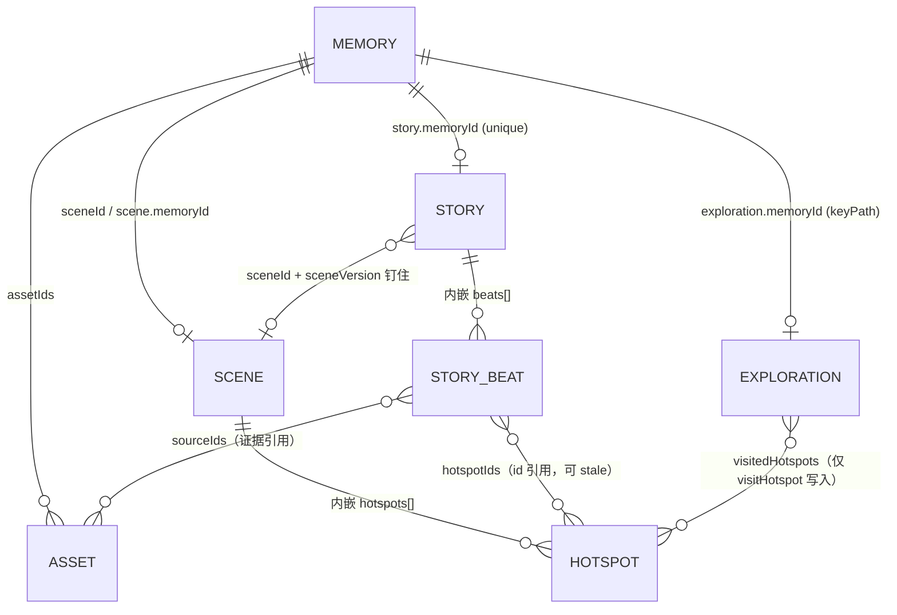
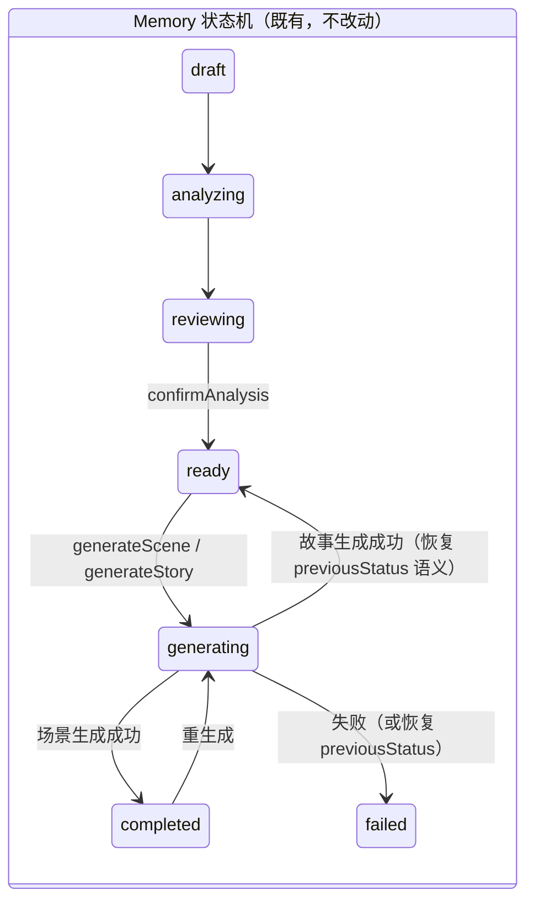

# T1 · Story 领域模型设计

状态：设计定稿（仅文档，不含实现）
输入：`src/schemas/*`、`src/lib/constants.js`、`src/services/ai/aiService.js`、`src/services/storage/memoryRepository.js`、AGENTS.md §4/§5/§7

## 0. 现有模型事实（设计依据）

- Memory 是聚合根：`memorySchema` 持有 `assetIds`、`sceneId`，状态机为 `MEMORY_STATUS`（draft → analyzing → reviewing → ready ⇄ generating → completed / failed）。
- Scene 与 Memory 1:1（`scene.memoryId` 所有权固定），原地重生成：id 不变、`version` 递增（aiService.js:340-351）。
- Exploration 以 `memoryId` 为 keyPath，只存 `visitedHotspots`（hotspot id 列表）；`visitHotspot` 在写入前校验 hotspot 仍存在（sceneService.js:28-30）。
- 溯源统一走 `sourcedValue` 五字段（value / sourceType / sourceIds / confidence / confirmed），`assertConfirmedProvenance` 保证只有 `user_confirmed` 可标 confirmed。
- facts 条目 currently 无独立 id；`sourceIds` 在各 provider 中均为空数组，是预留的溯源引用位。
- Memory 删除在同一事务内级联 assets / scenes / explorations（memoryRepository.js:87-107）。

## 1. 三个决策点

### D1 · Story 与 Memory：1:1（MVP 内不聚合多段 Memory）

**结论**：一个 Story 恰好归属一个 Memory，`story.memoryId` 为所有权外键，`stories` store 建 `byMemoryId` 唯一索引强制 1:1。

**理由**：
1. MVP 主链路（导入 → 理解 → 审阅 → 场景 → 热点探索）全部以单段 Memory 为单位；Scene、Exploration 已是 1:1，Story 保持同构，关系图不引入新的基数。
2. 聚合多段 Memory 需要跨记忆排序、冲突事实合并、跨记忆溯源与集合管理 UI，后者触碰 §7 禁区（博物馆收藏系统），前者无当前需求支撑（§6：不提前实现未来特性）。
3. 1:1 不堵死未来聚合：将来若需要"多记忆故事集"，可新增上层实体引用多个 story.id，本实体无需破坏性变更。

**被否方案**：`memoryIds: string[]` 有序数组。否因：为假想需求引入排序/去重/级联复杂度，且与 scene/exploration 的单记忆所有权不一致。

### D2 · Story 是持久化实体（不是 facts/scene 的派生视图）

**结论**：新增 `stories` object store（keyPath `id`，索引 `byMemoryId` 唯一），Story 经 Repository 持久化，DB_VERSION 由 1 升至 2。

**理由**：
1. Story 的叙事段落是**新生成的内容**，不是 facts 的投影：facts 是条目化 sourced value，叙事是 AI 组织的连贯文本，无法从 facts 确定性推导。
2. 派生视图每次渲染都要重跑 provider，输出不确定，且无法承载用户编辑与逐段溯源；§4 要求本地持久化并保留实体关系，编辑过的叙事必须跨刷新存活。
3. 生成是异步过程（与 buildScene 同型），需要落库的结果与版本记录来支撑"重生成 / 失效检测"。

**边界**：Story 只存叙事与引用，**不复制** facts、hotspot、asset 的任何数据体；事实本体仍以 Memory.facts 为唯一权威来源。若未来 Story 退化为"facts 的只读排序视图"，本决策应重新评估。

### D3 · Story 与 Scene hotspot / Exploration 的引用方式

**结论**：
- **对 hotspot：id 引用 + 版本钉住。** Story 记录 `sceneId` + `sceneVersion`（生成时绑定的场景版本快照）；每个 beat 持 `hotspotIds: string[]`，指向 scene.hotspots[].id，绝不内嵌 hotspot 数据。
- **对 Exploration：无直接外键，经 memoryId 间接关联。** Story 读取访问状态走 `ExplorationRepository.getByMemoryId(story.memoryId)`；从故事节拍跳转热点时复用现有 `visitHotspot(memoryId, hotspotId)`，Story 永不直接写 `visitedHotspots`。

**理由**：
1. hotspot id 是场景内局部 UUID，跨场景无意义，因此引用必须连同 sceneId/sceneVersion 一起解读；钉住版本使"场景重生成后故事引用失效"可被**检测**而非静默错链。
2. 失效处理与 visitHotspot 的既有规则同构：读取时若 `scene.version !== story.sceneVersion` 或 hotspotId 不存在，视图层将该 beat 链接标记为 stale（派生状态，不落库），引导重生成故事重新绑定；不产生孤儿写入。
3. Exploration 以 memoryId 为键、与 Story 1:1 同域，直接外键是冗余；访问校验/去重逻辑集中在 visitHotspot 一处，Story 另写一份会破坏"探索记录永远指向现存热点"的不变量。

## 2. 实体字段表

### 2.1 Story（stories store，keyPath: id）

| 字段 | 类型 / 约束 | 默认 | 说明 |
| --- | --- | --- | --- |
| id | string，UUID，min(1) | 仓库 stamped | 实体主键 |
| memoryId | string，UUID，min(1) | 必填 | 所有权外键，创建后不可变（patch omit） |
| sceneId | string，min(1)，nullable | null | 生成时绑定的场景；无场景时为 null |
| sceneVersion | int positive，nullable | null | 与 sceneId 成对：superRefine 要求同 null 或同非 null |
| title | string，trim，1..120 | 必填 | 故事标题 |
| beats | storyBeatSchema 数组，1..MAX_BEATS | [] | 叙事节拍，数组顺序即阅读顺序，id 唯一（superRefine） |
| version | int positive | 1 | 重生成递增，id 不变（与 scene 同策略） |
| createdAt | int 非负 | 仓库 stamped | |
| updatedAt | int 非负 | 仓库 stamped | |

schema `.strict()`；`storyPatchSchema = storySchema.omit({ id, memoryId, createdAt }).partial()`。

### 2.2 StoryBeat（内嵌于 Story，不独立建 store）

| 字段 | 类型 / 约束 | 默认 | 说明 |
| --- | --- | --- | --- |
| id | string，UUID，min(1) | 必填 | beat 主键，供 UI key 与将来引用 |
| text | string，trim，1..MAX_BEAT_LENGTH | 必填 | 叙事段落文本 |
| sourceType | sourceTypeSchema | 必填 | 该段文字的溯源类别（见 §4） |
| sourceIds | string 数组（asset id） | [] | 支撑该段的图片证据引用 |
| confidence | number 0..1 | 0 | |
| confirmed | boolean | false | 受 assertConfirmedProvenance 约束 |
| hotspotIds | string 数组（hotspot id） | [] | 该段可跳转的热点；仅在 sceneId 非 null 时允许非空（superRefine） |

复用 `sourcedValueBaseSchema.extend({ id, text, hotspotIds })` 的构造方式，与 analysisItemSchema 同型，保证溯源校验不另造一套。

### 2.3 新增常量（建议值，实现时落 constants.js）

```
STORES.stories = "stories"
INDEXES.stories = { byMemoryId: "memoryId" }   // unique: true
STORY_LIMITS = { MAX_BEATS: 12, MAX_BEAT_LENGTH: 1000 }
STORY_INITIAL_VERSION = 1
```

不新增任何 status 枚举、不新增 SOURCE_TYPES。

## 3. 关系图



删除级联：Memory 删除事务需追加 `deleteByIndex(tx, STORES.stories, byMemoryId, memoryId)`，与 assets/scenes/explorations 同事务，Story 无独立生命周期残留。

## 4. 溯源与真实性约束（§5）

1. **叙事文字本身是 AI 创作**：即使素材全部来自 user_confirmed facts，provider 产出的 beat 一律 `sourceType: ai_inferred, confirmed: false`。确认事实 ≠ 确认叙事，禁止把 AI 措辞洗成已确认记忆。
2. 用户编辑并采纳某段后，该段经 `confirmedCopy` 同型路径转为 `user_confirmed, confirmed: true`；未经采纳的段落永远带"AI 推测"徽标（SOURCE_TYPE_LABELS 已有文案）。
3. `sourceIds` 只允许指向本 Memory 的 asset id；beat 不得引用其他 Memory 的资产（1:1 所有权决定）。
4. 不生成真实人物身份与人际关系：provider 输入沿用 sceneGenerationInputSchema 的边界（标题、已确认 objects、分类标签、图片数量），不传文件名与图片字节；叙事 prompt 约束不得虚构人名/关系，想象性内容必须显式 `fictional`。
5. 每个 beat 的溯源五字段齐备，UI 可逐段展示来源类别；无来源的段落不允许落库（schema 强制）。

## 5. 生命周期状态机（与 MEMORY_STATUS 协调）

**原则：Story 不自带 status 字段。** 其生命周期由三个既有信号合成：Memory.status（门控与在途标记）、story 行是否存在（是否已生成）、story.version + sceneVersion 比对（新鲜度，派生）。



Story 叠加视图（派生，不落库）：

| Story 阶段 | 判定条件 | 说明 |
| --- | --- | --- |
| 未生成 | stories 无行 | 入口仅在 memory.status ∈ {ready, completed} 时可用 |
| 生成中 | memory.status = generating 且 inFlight 命中 | 复用 GENERATING 与 aiService 同一 inFlight 守卫，故事/场景生成互斥，不并发写同一 Memory |
| 已生成 vN | story 行存在，version = N | 失败时按 generateScene 同型恢复 previousStatus，不留半成品行 |
| 引用失效 stale | scene.version ≠ story.sceneVersion，或 beat.hotspotIds 含不存在 id | 读取时派生标记，提示重生成；不阻塞纯文本阅读 |
| 已删除 | 随 Memory 级联删除 | 无独立删除入口（MVP） |

协调要点：
- 生成门控与 generateScene 完全一致（aiService.js:297）：未确认的 draft 不得生成故事，防止把猜测洗成记忆。
- GENERATING 是 Memory 级"有生成任务在途"的单一标记，Story 不新增平行状态，避免两套状态机互相覆盖；失败恢复 previousStatus 的既有模式原样沿用。
- 重生成原地更新：story.id 不变、version+1，与 scene 的重生成策略一致，UI 书签/引用不失效。
- 场景重生成不自动改写 Story（避免静默篡改用户已读内容），只令其派生为 stale，由用户决定重生成。

## 6. MVP 边界（§7 自检）

- 不做跨 Memory 故事聚合、不做故事收藏/展馆、不做多身份叙事、不做 AI 角色对话、不做社交分享。
- Story 只新增一个 store、一个 schema 文件、一个 Repository、一个 service 生成入口；不改动 memorySchema / sceneSchema / explorationSchema 的既有字段。
- facts 条目仍无 id：beat 对事实的溯源经 sourceType + sourceIds(asset) 表达，不在本任务给 facts 发明 id 体系（那会改动 memorySchema，越出最小变更）。

## 7. 验收对照

| 验收项 | 落点 |
| --- | --- |
| 每个信息项可溯源 | beat 强制 sourcedValue 五字段 + assertConfirmedProvenance（§2.2、§4） |
| 不虚构真实人物身份/关系 | provider 输入边界 + fictional 显式标注（§4.4） |
| 不越出 MVP | 1:1、单 store、无新枚举、无 §7 禁区特性（§1、§6） |
| 三决策点有结论与理由 | D1 1:1 / D2 持久化 / D3 id 引用+版本钉住、Exploration 间接关联（§1） |
| 状态机与 MEMORY_STATUS 协调 | Story 无自有 status，复用 GENERATING 门控与恢复模式（§5） |

## 8. 对后续任务的实现提示（非本任务产出）

- db.js：DB_VERSION 2，upgrade 中创建 stories store 与唯一 byMemoryId 索引。
- memoryRepository.delete：CASCADE_STORES 与事务内追加 stories 级联。
- aiService：generateStory 沿用 inFlight / previousStatus / requireMemory 模式；provider 接口新增 buildStory（mock 先行，simulated 标记同 analysisDraft）。
- 新错误码建议：STORY_NOT_FOUND / STORY_ALREADY_EXISTS / STORY_NOT_CONFIRMED / STORY_GENERATION_IN_PROGRESS / STORY_GENERATION_FAILED / STORY_INVALID_RESULT（与 SCENE_* 同型）。